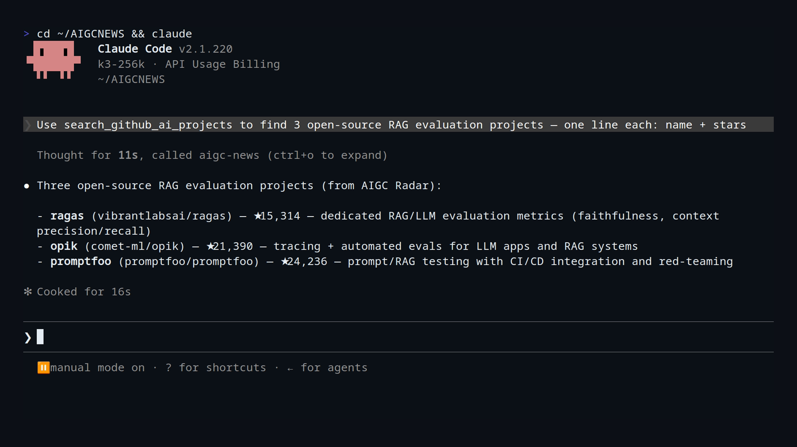

<div align="center">
  
</div>

<p align="center">
  <a href="README.zh-CN.md">简体中文</a> | <strong>English</strong>
</p>

<p align="center">
  <a href="https://aigcnews.cn/mcp?utm_source=github&utm_medium=readme"></a>
  <a href="https://github.com/Kaixxrua/AIGC_NEWS/actions/workflows/contract-baseline.yml"></a>
  <a href="LICENSE"></a>
  <a href="https://cursor.com/en-US/install-mcp?name=aigc-radar&config=eyJ1cmwiOiJodHRwczovL2FpZ2NuZXdzLmNuL2FwaS9tY3AifQ=="></a>
  <a href="https://aigcnews.cn/mcp?utm_source=github&utm_medium=readme"></a>
</p>

# AIGCNEWS

An AI discovery & intelligence platform for engineers, researchers, and AI agents: continuously indexes arXiv / HuggingFace papers, GitHub AI projects, tech news, Product Hunt, Hacker News, and X (Twitter) hotspots — then enriches them into browsable rankings, searchable libraries, and subscribable briefs. The same dataset is served through two interfaces:

- **AIGC Radar MCP** — an MCP data interface for agents (flagship)
- **Web Site** — rankings, project library, and briefings for human readers ([aigcnews.cn](https://aigcnews.cn))

## Benchmarks

Numbers first — everything below measures the flagship [AIGC Radar MCP](#aigc-radar-mcp-flagship-interface) interface detailed later in this README:


- **3.5× faster than WebSearch** at median end-to-end (7.4 s vs 25.8 s across 10 representative queries), measured 2026-08-11
- **160 ms median MCP tool execution** (30–800 ms range); server-side latency p50 360 ms / p95 710 ms, measured 2026-08-11
- **98.3% first-tool routing accuracy** (59/60 trials: 100% on unambiguous intents, 90% on mixed intents), measured 2026-08-12

<details>
<summary>Full tables, methodology & reproduce commands</summary>

Server-side latency, measured 2026-08-11 with [scripts/benchmark_mcp_latency.py](scripts/benchmark_mcp_latency.py) (JSON-RPC over Streamable HTTP, 6 representative tools × 3 trials, 18 timed `tools/call` requests):

| Endpoint | p50 | p95 | Notes |
| --- | --- | --- | --- |
| Self-hosted `http://localhost:8000/api/mcp` | 360 ms | 710 ms | backend query processing is sub-second |

Agent end-to-end vs WebSearch, measured 2026-08-11 with [scripts/benchmark_agent_tool_latency.py](scripts/benchmark_agent_tool_latency.py): headless `claude -p` (claude-opus-4-8, effort low), MCP pointed at `http://127.0.0.1:8000/api/mcp`, wall clock from process spawn to the complete answer, both sides instructed to answer in at most two sentences, 10 distinct queries × 1 run per path:

| Query | AIGC Radar MCP | — of which tool exec | WebSearch |
| --- | --- | --- | --- |
| self-hosted LLM observability platform open source | 9.6 s | 802 ms | 13.4 s |
| open source screenshot tool for Windows with rounded corners | 7.7 s | 66 ms | 38.8 s |
| mixture of experts load balancing paper | 6.7 s | 96 ms | 19.8 s |
| Sora video generation model | 6.2 s | 204 ms | 42.4 s |
| trending GitHub repositories this week | 9.4 s | 748 ms | 10.7 s |
| MCP server for database access | 8.7 s | 510 ms | 10.0 s |
| self-hosted photo management like Google Photos | 32.9 s | 41 ms | 31.8 s |
| RLHF reward model overoptimization paper | 7.0 s | 139 ms | 17.4 s |
| top Hacker News stories this month | 6.8 s | 31 ms | 52.2 s |
| Claude Code agent skills | 6.7 s | 178 ms | 54.8 s |
| **Median** | **7.4 s** | **160 ms** | **25.8 s** |

MCP finished under 10 s in 9 of 10 pairs while WebSearch never went below 9.9 s — **3.5× faster at the median**. Pure MCP tool execution (`tool_use` → `tool_result`) was 160 ms at the median (30–800 ms); WebSearch executes its search inside the API turn (server-side tool), so no equivalent client-observable window exists. The 32.9 s MCP outlier is a model-API stall, not tool cost (its tool call took 41 ms) — the median filters such spikes.

Tool-selection accuracy, measured 2026-08-12 with [scripts/eval_mcp_tool_selection.py](scripts/eval_mcp_tool_selection.py): headless `claude -p` (claude-opus-4-8, effort high) with both host tools and all 7 MCP tools available; a trial passes only if the **first** tool call is the expected AIGC Radar tool with no host-tool detour:

| Probe set | Accuracy |
| --- | --- |
| 9 unambiguous probes (one at 10 trials, eight at 5) | **100%** (50/50) |
| 2 mixed-intent probes (5 trials each) | **90%** (9/10) |
| **Overall (11 probes, 60 trials)** | **98.3%** (59/60) |

Unambiguous probes held 100% in the baseline run; post-change reruns missed only on infrastructure flakes (a harness timeout, a 429 rate-limit that exhausted retries before the first assistant turn), never on wrong-tool routing — so the table pairs the baseline unambiguous count with the post-change mixed-intent count (same harness, same day). Mixed-intent prompts explicitly invite both deliverable types ("projects primarily, papers as a supplement"): earlier runs hedged by calling both candidate tools in parallel, the routing rules in the tool descriptions eliminated that pattern entirely, and the one remaining mixed miss is a model reading a fragment-style prompt as a preference-setting instruction and saving it to memory via Bash — a prompt-interpretation quirk, not wrong-tool routing.

Reproduce:

```bash
python3 scripts/benchmark_mcp_latency.py --url http://localhost:8000/api/mcp --trials 3
python3 scripts/benchmark_agent_tool_latency.py  # requires the claude CLI
python3 scripts/eval_mcp_tool_selection.py       # requires the claude CLI
```

</details>

## Demo


| Daily Dashboard Rankings | GitHub AI Project Library |
| --- | --- |
|  |  |

| Semantic project search ("mcp server") |
| --- |
|  |

## Features

- **Multi-source dashboard** — papers / GitHub / news / Product Hunt / Hacker News / X rankings on one board (daily / weekly / monthly), snapshot archives replayable by date, and a GitHub hot score that goes beyond raw stars
- **GitHub AI project library** — 18,000+ curated projects and tool sites with a ≥ 500-star admission bar, bilingual taxonomy & tags, PostgreSQL keyword × Milvus semantic hybrid search, today +N star growth on every card, and URL-synced shareable filters
- **Paper discovery & reading** — arXiv / HuggingFace daily hot papers, paper summaries and original links, background PDF text/figure extraction, full-text indexing, and daily reports
- **X board** — curated timelines with per-date snapshots and embargo windows, Chinese translations with restored @ mentions
- **Smart briefs & subscriptions** — SSE-streamed daily / weekly / monthly briefs per direction (zh/en), email subscriptions per source & frequency with send-now delivery
- **Favorites & private bookshelf** — optimistic favorites with personal tags and cross-device sync, URL-submit tool shelf with AI enrichment, strict public/private data separation
- **Accounts & admin console** — email OTP + JWT (empty-DB first boot seeds a default admin; in-app password change needs only the current password, no mail), ingestion monitor, model providers with real connection tests, DB-backed SMTP panel, crawl & enrichment queues with retry / circuit breaking

Full feature walkthrough: [docs/project-overview.md](docs/project-overview.md) (in Chinese)

## AIGC Radar MCP (Flagship Interface)

AIGC Radar is the flagship interface of this project: a Streamable HTTP MCP Server that lets MCP clients such as Claude Code query the platform directly, with a built-in MCP-first open-source project discovery and reuse policy (local-first, 500-star admission threshold, limited read-only GitHub fallback). Unlike general-purpose news/hot-topic MCPs, it is an AI-vertical structured index: arXiv papers, a curated and enriched GitHub AI project library (category taxonomy, Chinese/English tags, star-growth snapshots), and multi-source daily/weekly/monthly rankings — hosted, ready to connect, public and read-only.

```text
https://aigcnews.cn/api/mcp
```

Connect from Claude Code:

```bash
claude mcp add --transport http aigc-radar https://aigcnews.cn/api/mcp
```

Any MCP client that supports Streamable HTTP can point directly at this URL; the Web site offers one-click import configs for 9 client types (Cursor, Codex, VS Code, Windsurf, etc.); stdio-only clients can bridge via `npx mcp-remote https://aigcnews.cn/api/mcp`. For self-hosted local development, the endpoint is `http://localhost:8000/api/mcp`.

[dsh](https://github.com/deepseek-ai/deepseek-harness) (DeepSeek Harness) users can skip manual MCP setup and install the native plugin [dsh-aigc-radar](https://github.com/Kaixxrua/dsh-aigc-radar): it rides the same `/api/mcp` endpoint, but renders results as native search cards in the dsh Web UI and ships a proactive reuse check out of the box.

```sh
# Recommended: prebuilt npm package
dsh plugin --profile web add dsh-aigc-radar

# Reproducible: pin the published release
dsh plugin --profile web add dsh-aigc-radar@0.2.0

# Source fallback
dsh plugin --profile web add github:Kaixxrua/dsh-aigc-radar
```

GitHub installs run a source build; see the [plugin README](https://github.com/Kaixxrua/dsh-aigc-radar#install) for pnpm build approval and commit-pinning details.

MCP and `/api/v1` share one quota pool: anonymous callers get 30 calls per fixed 24-hour window per IP; free accounts get 60 per fixed 24-hour window plus 1,200 per rolling 30-day window; members get 400 plus 8,000. For authenticated callers, the 24-hour pacing bucket is checked first, so hitting it does not consume the rolling-30-day quota.



Public tools (no auth required; all read-only except the append-only adoption receipt):

| Tool | Purpose |
| --- | --- |
| `search_github_ai_projects` | Local-first search of the curated GitHub AI project library (AI/Agent/MCP/RAG/LLM engineering artifacts) |
| `search_github_projects` | Search non-AI GitHub open-source software and components |
| `get_github_project_detail` | Optionally inspect one public repository and its original README, including installation commands and links |
| `search_papers` | arXiv paper search |
| `search_documents` | Cross-source index search (arXiv / GitHub / news / Product Hunt / Hacker News) |
| `get_top_items` | Daily / weekly / monthly ranking snapshots |
| `get_paper_detail` | Details for a single indexed document |
| `get_project_categories` | Project categories with subcategory counts |
| `submit_project_adoption` | Adoption receipt: after a search leads to a concrete decision, report it once (adopted / reference_only / declined) — powers the reuse-rate metric |

Sending `Authorization: Bearer <MCP access token>` additionally unlocks `search_my_project_favorites` (personal favorites search) and, for members, `get_my_tracking` (what your keyword and GitHub project tracking rules matched in recent daily tracking issues). Logged-in users can mint minimal-scope, revocable read-only tokens with device labels and expiry — the plaintext token is shown only once, and the server stores only its digest.

You can also skip copying a token: point an OAuth-capable client at the OAuth entry instead. It answers with a 401 challenge carrying RFC 9728 resource metadata; the client registers itself (dynamic client registration), opens this site's authorization page in your browser, and receives its own token once you sign in and click Allow. In Claude Code:

```bash
claude mcp add --transport http aigc-radar https://aigcnews.cn/api/mcp/oauth
claude mcp login aigc-radar   # older Claude Code: run /mcp, pick aigc-radar, choose Authenticate
```

Codex, Cursor, VS Code, and OpenCode run the same flow, and the `/mcp` page generates the command for each of them. Authorizing the same client again replaces its previous token. The OAuth entry is bound to `aigcnews.cn`: on the fallback domain, or for clients without MCP OAuth support, use a manual token. The anonymous `/api/mcp` endpoint is unchanged.

**The reuse loop** — the product bet is "while building, the AI proactively surfaces mature technology instead of reinventing wheels", and the loop is closed end to end: deterministic triggers (a [dsh plugin](https://github.com/Kaixxrua/dsh-aigc-radar) listening on `agent/pre-step`, a Claude Code `UserPromptSubmit` hook, and the MCP `instructions` themselves) nudge the agent to search *before* writing code; the search tools answer with curated, star-gated projects; the agent files one adoption receipt (`submit_project_adoption` or `POST /api/projects/adoptions`) recording adopted / reference_only / declined; receipts aggregate into a reuse-rate metric at `GET /api/projects/adoptions/stats`. Full mechanics, decision semantics, and hook recipes: [docs/reuse-loop.md](docs/reuse-loop.md).

On the context side, it provides resources (`aigc-news://dashboard/summary`, `aigc-news://report/latest`, etc.), resource templates, and prompts (`daily_research_brief`, `project_discovery`). For full protocol parameters, the MCP-first policy, and fallback semantics, see [docs/mcp-server.md](docs/mcp-server.md).

<details>
<summary>Sample structured response & the 500-star quality bar</summary>

**Structured JSON responses** — WebSearch hands you links; AIGC Radar hands you data. One trimmed record from `search_github_ai_projects`:

```json
{
  "full_name": "rag-web-ui/rag-web-ui",
  "url": "https://github.com/rag-web-ui/rag-web-ui",
  "description_zh": "基于 RAG 的智能对话 Web UI，适合搭建私有知识库问答与文档检索助手。",
  "category_name_zh": "RAG / 知识库",
  "subcategory_name_zh": "文档问答",
  "tags_zh": ["文档问答", "检索增强生成", "知识库", "Web 界面"],
  "tags_en": ["Document Q&A", "RAG", "Knowledge base", "Web UI"],
  "language": "TypeScript",
  "stars": 3257,
  "daily_star_growth": 1,
  "hot_score": 2.5899,
  "pushed_at": "2026-04-06T14:22:58Z",
  "detail_url": "https://aigcnews.cn/projects?q=rag-web-ui%2Frag-web-ui&utm_source=mcp&utm_medium=tool"
}
```

- Bilingual fields: `description_zh` / `tags_zh` / `tags_en` plus a zh/en category taxonomy — one index serves both Chinese and English queries.
- Quality signals inline: `stars` / `forks` / `daily_star_growth` / `hot_score` / `pushed_at` — no extra GitHub API call needed.
- Transparent admission and provenance: 500-star admission (`min_stars`), `result_origin` / `fallback_used` state where results came from, and `attribution` / `detail_url` link back to the detail pages.

**Quality-filtered index** — Every GitHub project in the library passed a **500-star admission bar** (`min_stars`) before curation — toy repos, abandoned forks, and low-signal projects never enter the index, so results are high quality by construction, with no post-filtering left to the agent. WebSearch has no such gate: it ranks whatever the open web returns, including unmaintained or trivial repositories, and leaves the quality judgment to you.

- Enforced everywhere: the 500-star floor applies both at ingestion and on the limited read-only GitHub fallback — below-bar results are excluded before they reach the agent.
- Curated, not just crawled: admitted projects get a category taxonomy, bilingual tags, and star-growth snapshots, so ranking signals stay current.

</details>

## Architecture

```text
Sources (arXiv/HF · GitHub · Techmeme · Product Hunt · HN · X)
  → fetch & normalize → enrich (README / PDF completion, AI scoring, tagging, zh descriptions)
  → PostgreSQL master write → ranking snapshots
  → Milvus vector index · Neo4j paper graph → cache invalidation
  → Dashboard · project search · briefs · MCP
```

Vue 3 + TypeScript frontend · FastAPI layered monolith · PostgreSQL 16 as the sole relational runtime · Milvus vectors + Neo4j paper graph · Redis cache — single-node Docker Compose with an in-process scheduler (Asia/Shanghai). Full stack table and module breakdown: [docs/architecture.md](docs/architecture.md) (in Chinese). The backend also ships a hybrid-RAG chat pipeline (recall, rerank, streaming, multi-session), which powers the AI conversation beside each paper.

## Quick Start (Linux / WSL2)

Requires Python 3.12 · Node.js 22 · Docker Compose v2. **A clean checkout runs as-is:**

```bash
cp .env.example .env
# then edit .env: JWT_SECRET_KEY is required (openssl rand -hex 32) — the app refuses weak or missing values
python3.12 -m venv backend/.venv && backend/.venv/bin/python -m pip install -r backend/requirements-dev.txt
(cd frontend && npm ci)
# frontend-web nginx requires certs (self-signed is fine); the hardened container wants the key root:root 600
mkdir -p frontend/ssl && openssl req -x509 -newkey rsa:2048 -nodes -keyout frontend/ssl/aigcnews.cn.key -out frontend/ssl/aigcnews.cn_bundle.crt -days 3650 -subj "/CN=aigcnews.cn"
sudo chown root:root frontend/ssl/*.key && sudo chmod 600 frontend/ssl/*.key
scripts/manage_main_stack.sh up
```

First-run notes: on an empty database the backend seeds a default admin (`admin@aigcnews.internal` / `admin123456`, overridable via `DEFAULT_ADMIN_*`) so deployments without SMTP can log in immediately — change the password right away via the in-app dialog (current password only, no mail needed). Registration and password recovery still need a working mail channel — configure `SMTP_*` in `.env`, or leave `SMTP_HOST` empty for dev mode which prints codes to the backend logs. TLS details, ports & health checks, hot-reload dev mode, testing commands, and the private-overlay mechanism: [docs/self-hosting.md](docs/self-hosting.md)

## Directory Structure

```text
backend/            FastAPI app (app/), tests (tests/), migrations (migrations/), locked dependencies
frontend/           Vue 3 + Vite site (src/), nginx config, frontend image
docker/             Compose orchestration (core stack) and backup-drill orchestration (private extensions injected via overlay)
docs/               Project documentation (index in docs/README.md, decision records in docs/adr/)
scripts/            Stack management, migration, backup, and data backfill scripts
.github/workflows/  CI: backend tests, PostgreSQL integration, frontend build & lint, orchestration smoke
.githooks/          commit-msg validation (git config core.hooksPath .githooks)
```

## Documentation

- [docs/self-hosting.md](docs/self-hosting.md) — Full self-hosting guide: TLS certificates, default admin & SMTP, ports, testing
- [docs/project-overview.md](docs/project-overview.md) — Project panorama: positioning, data sources, and per-module feature walkthrough (in Chinese)
- [docs/architecture.md](docs/architecture.md) — Current architecture for developers: layering, API surface, storage, scheduling, deployment (in Chinese)
- [docs/mcp-server.md](docs/mcp-server.md) — AIGC Radar MCP protocol parameters and policies (in Chinese)
- [docs/README.md](docs/README.md) — Full documentation index, including historical archive annotations (in Chinese)

## Data Ownership & Compliance

- **Aggregated content is not ours.** Papers, repository metadata, news, Product Hunt / Hacker News items, and X posts surfaced by the pipelines remain the property of their original authors and platforms. AIGCNEWS stores metadata, excerpts, and thumbnails solely to operate the reader and claims no ownership. No database dump, collected snapshot, or cached media from the reference deployment is part of this repository or licensed for redistribution.
- **X implementation is public.** The X (Twitter) read/parse/pagination transport ships in this repository behind the default-off `x_source_enabled` feature flag (see `backend/app/services/ingestion/sources/x_transport.py`). Real X cookies/tokens, encrypted credential rows, private overlays, proxy topology, deployment configuration, database dumps, collected snapshots, and media caches are not included. When disabled or unconfigured, X ingestion skips safely; other features work unchanged.
- **Operating your own instance** with these sources is your responsibility: comply with the source platforms' Terms of Service, robots policies, and applicable law, and safeguard any credentials (cookies/tokens) you configure.
- **Marks.** X, Twitter, WeChat, Product Hunt, Hacker News, arXiv, GitHub, and Hugging Face are property of their respective owners; references are nominative, with no affiliation or endorsement implied.
- **Removal requests** for aggregated content: open an issue or contact the maintainer. See [NOTICE](NOTICE) for the full attribution text.

## Contributing & Security

- [CONTRIBUTING.md](CONTRIBUTING.md) — dev environment, commit conventions (Conventional Commits, scope required), and PR expectations (in Chinese)
- [SECURITY.md](SECURITY.md) — supported versions and private vulnerability reporting (in Chinese)
- [CODE_OF_CONDUCT.md](CODE_OF_CONDUCT.md) — Contributor Covenant 2.1 (in Chinese)
- Testing & quality checks (pytest, ruff, Vitest, typecheck, build, compose config): [docs/self-hosting.md#testing](docs/self-hosting.md#testing)

## License

[GNU Affero General Public License v3.0](LICENSE) © 2026 Kaixxrua — free to use, modify, and self-host, including commercially; if you run a modified version as a public network service, you must offer its source under AGPL-3.0. Commercial licensing available on request.

**Brand assets are not open source.** The AGPL-3.0 grant covers code and documentation only. The AIGCNEWS / AIGC Radar names, the logos, wordmarks, favicons, and app icons, the comic illustrations and stickers in `frontend/public/assets/comic/`, and the screenshots and promo media in `docs/assets/` are © Kaixxrua, all rights reserved. If you distribute a fork or run a public deployment, replace them with your own assets and name, and do not present it as the official service. See [NOTICE](NOTICE) for the full list and terms.
