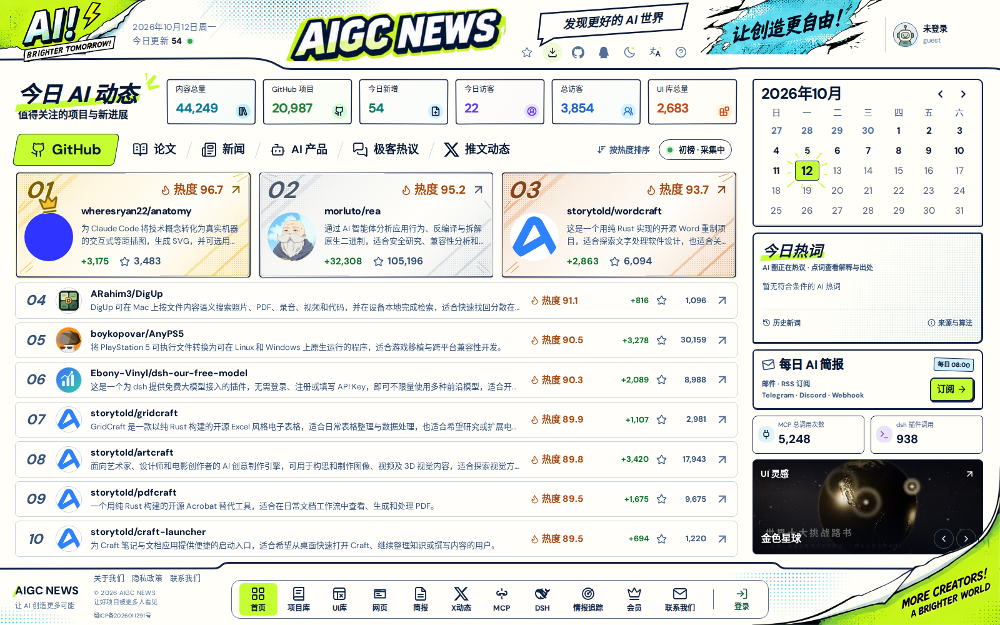
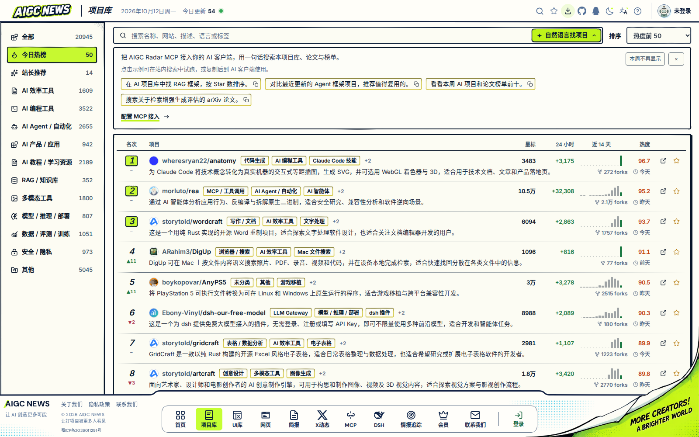
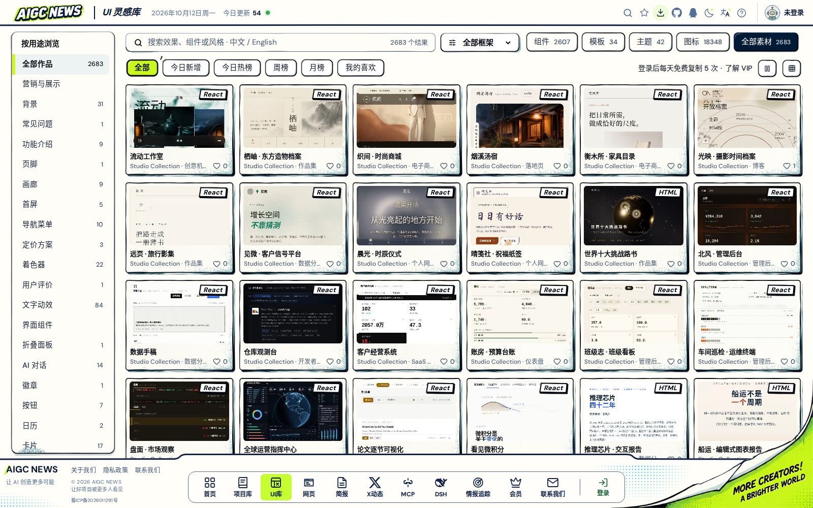
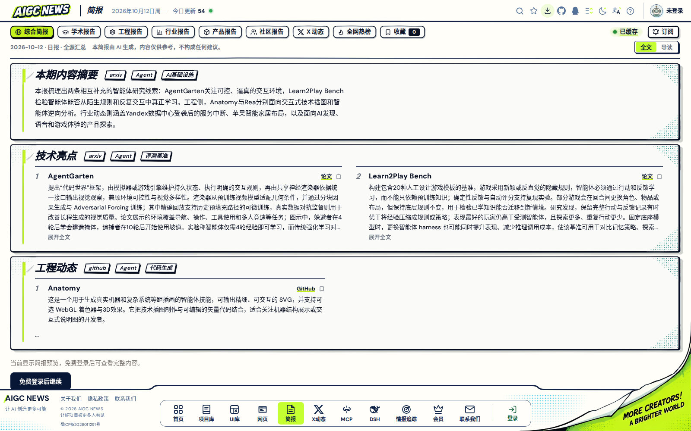
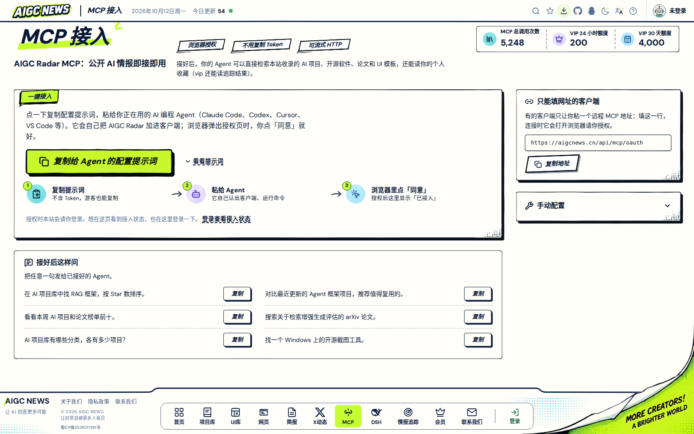
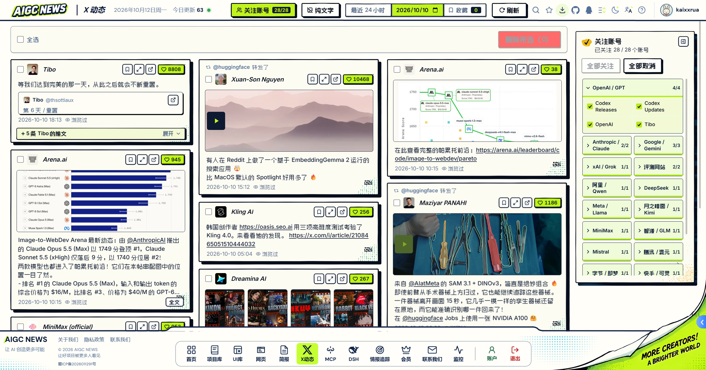
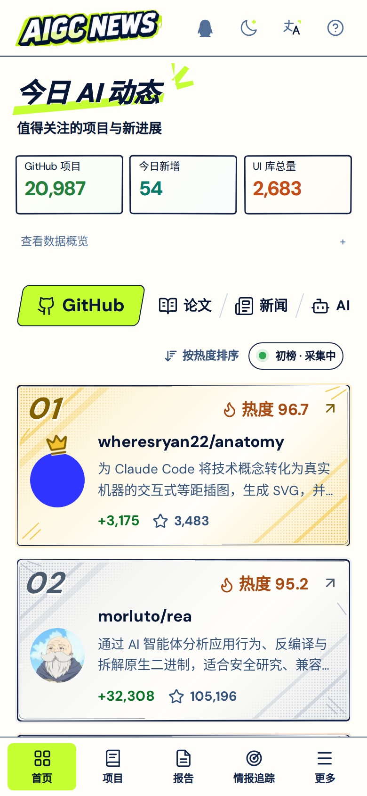

<div align="center">
  
</div>

<p align="center">
  <a href="README.zh-CN.md">简体中文</a> · <strong>English</strong>
</p>

<p align="center">
  <a href="https://aigcnews.cn/">Live site</a> ·
  <a href="https://aigcnews.cn/projects">Projects</a> ·
  <a href="https://aigcnews.cn/ui-library">UI library</a> ·
  <a href="https://aigcnews.cn/mcp">Connect MCP</a> ·
  <a href="docs/README.md">Documentation</a>
</p>

# AIGCNEWS

**Discover AI projects, papers, and developments worth following—and bring useful tools into your work.**

AIGCNEWS organizes open-source projects, research papers, products, and industry updates into a searchable collection with historical rankings and personal tracking. Browse the website to find projects, preview UI assets, and read briefings, or let your agent search the same data through **AIGC Radar MCP**.



## What you can do

| Entry point | Capabilities |
| --- | --- |
| [AI dashboard](https://aigcnews.cn/) | Switch between GitHub, papers, news, AI products, Hacker News, and X updates. Compare ranking scores and Star growth, revisit earlier dates, and explore AI terminology with explanations and sources. |
| [Project library](https://aigcnews.cn/projects) | Search by natural language, category, tags, or programming language. Compare total Stars, 24-hour growth, 14-day trends, and rank changes; open project details and READMEs, or save favorites. |
| [Website collection](https://aigcnews.cn/projects?source=website) | Browse and filter useful websites. Sign in to organize your own project and website favorites. |
| [UI library](https://aigcnews.cn/ui-library) | Explore components, page templates, themes, and icons. Filter by use, style, or framework, preview effects, copy source code or integration prompts, and inspect dependencies, origins, and licenses. |
| Paper reader | Open papers from the rankings to read abstracts, PDFs, and original sources. Sign in to use paper conversations. |
| [AI briefings](https://aigcnews.cn/report) | Read general, research, engineering, industry, product, and community editions. Switch between the full text and reading guide; guests can preview a briefing and sign in for the complete content. |
| [Personal tracking](https://aigcnews.cn/subscriptions) | Follow keywords or a project's Star growth. Receive a personal digest on the website, with optional delivery to verified email, Telegram, Discord, or webhook channels. |
| [X updates](https://aigcnews.cn/x) | Choose accounts grouped by AI company and model ecosystem. Read Chinese translations, images, and videos from the last 24 hours or a selected date; desktop views support text-only reading and local bookmarks. Self-hosted instances must enable and configure the source. |

The website supports Chinese and English, light and dark themes, mobile layouts, and PWA installation. All active registered accounts can use the former member features for free, including 10 tracking rules and unlimited UI copying; login, token permissions, and call quotas still apply. New membership purchases are closed.

## Interface preview

These screenshots were captured from the live site in October 2026, with the interface set to Chinese. Content, dates, and counters change as the site updates.

| Projects: rankings, details, and growth trends | UI library: previews and filters |
| --- | --- |
|  |  |

| Briefings: summaries and topic sections | MCP: setup prompts and browser authorization |
| --- | --- |
|  |  |

**X updates: account groups, Chinese translations, and historical browsing**



<details>
<summary>View the mobile interface</summary>

<p align="center">
  
</p>

</details>

## Connect your agent to AIGC Radar

### MCP

1. Open the [MCP setup page](https://aigcnews.cn/mcp) and copy the setup prompt.
2. Paste it into your coding agent to configure its MCP client.
3. Clients that support browser authorization open a sign-in and consent page. Other clients can use the installation prompt or manual configuration available on the site.

| Connection | Streamable HTTP endpoint |
| --- | --- |
| Browser authorization | `https://aigcnews.cn/api/mcp/oauth` |
| Public tools / manual Bearer token | `https://aigcnews.cn/api/mcp` |

Once connected, try:

> Find RAG projects for a local knowledge base. Compare recent activity and Star growth.
>
> Find an animated React hero section and retrieve its original source, dependencies, and license.
>
> Search for papers on agent evaluation, then check the relevant weekly rankings.

| Task | Main tools |
| --- | --- |
| Find AI projects or other open-source software | `search_github_ai_projects`, `search_github_projects` |
| Inspect categories and project READMEs | `get_project_categories`, `get_github_project_detail` |
| Search papers, indexed content, and rankings | `search_papers`, `get_paper_detail`, `search_documents`, `get_top_items` |
| Find UI assets, source code, and icons | `search_ui_templates`, `get_ui_template`, `search_ui_icons`, `get_ui_icon` |
| Read personal favorites and tracking | `search_my_project_favorites`, `get_my_tracking` |
| Check remaining quota and reset times | `get_my_quota` |

Public tools accept anonymous calls. Personal tools, including tracking, are free for all active accounts with authorization and the relevant token scopes. MCP and `/api/v1` share a quota pool: 200 calls per 24 hours and 4,000 per rolling 30 days for registered accounts. See the [MCP page](https://aigcnews.cn/mcp), or call `get_my_quota` after signing in to inspect your actual balance. Tool parameters, resources, prompts, and authentication details are in the [MCP documentation](docs/mcp-server.md).

### Native dsh plugin

[dsh-aigc-radar](https://github.com/Kaixxrua/dsh-aigc-radar) uses the same MCP data, renders native search cards in the dsh Web UI, and includes prompts for project reuse.

```sh
dsh plugin --profile web add dsh-aigc-radar
```

Public tools work without a token. To use account quotas and personal features, follow the [DSH setup page](https://aigcnews.cn/dsh).

## Local development and self-hosting

The core toolchain is **Python 3.12, Node.js 22, Go 1.26, and Docker Compose v2**. The Go version is declared in [go.mod](mcp-go/go.mod); container builds provide their own toolchains.

```bash
git clone https://github.com/Kaixxrua/AIGCNEWS.git
cd AIGCNEWS
cp .env.example .env
openssl rand -hex 32
```

Set `JWT_SECRET_KEY` in `.env` to the generated value, then configure model services, email, third-party sign-in, and data sources as needed. A first deployment requires building images, preparing TLS certificates, and applying database migrations. `scripts/manage_main_stack.sh up` starts existing images.

- [Self-hosting guide](docs/self-hosting.md): environment variables, dependencies, certificates, ports, and local development.
- [Core Compose configuration](docker/docker-compose.yml): the actual backend, MCP, frontend, and storage services.
- [UI library documentation](docs/ui-library.md): catalog structure, source files, previews, and license evidence.

**Source code and live content are delivered separately.** The production database, credentials, full UI catalog release assets, and private deployment configuration are not distributed through this Git repository. Clean-checkout builds use a [minimal UI catalog fixture](scripts/ci/materialize_ui_catalog_fixture.py) for development and CI. It is not the production catalog; self-hosted instances need their own data and assets to reproduce the content shown in the screenshots.

## Repository structure

| Directory | Responsibility |
| --- | --- |
| `frontend/` | Vue 3, TypeScript, and Vite: website, mobile layouts, PDF reader, UI previews, and PWA. |
| `backend/` | FastAPI: accounts, REST/SSE, ingestion and scheduling, project search, paper processing, briefings, and tracking. |
| `mcp-go/` | Standalone Go MCP service: protocol handling, tools, authentication, quotas, and UI source retrieval. |
| `docker/` | Docker Compose services. PostgreSQL holds the primary data; Redis, Milvus, and Neo4j provide caching, vectors, and graph capabilities. |
| `scripts/` | Data maintenance, asset processing, migrations, builds, and delivery tooling. |
| `docs/` | Usage guides, architecture, operations, and design records. |

Ingestion normalizes and enriches source data into PostgreSQL, which supplies the website, search, rankings, briefings, and MCP. See the [architecture guide](docs/architecture.md) for module boundaries and data flows.

## Documentation and contributing

- [Documentation index](docs/README.md)
- [MCP protocol and setup](docs/mcp-server.md)
- [Personal tracking](docs/personal-tracking.md)
- [X source configuration](docs/x-source-runbook.md)
- [Contributing](CONTRIBUTING.md) · [Security reports](SECURITY.md) · [Code of conduct](CODE_OF_CONDUCT.md)

## License and content ownership

Code and documentation are licensed under [GNU AGPL-3.0](LICENSE). Project names, logos, comic illustrations, screenshots, and promotional assets are outside the open-source license. Public deployments and distributed forks must use their own branding; see [NOTICE](NOTICE).

Aggregated papers, project metadata, news, and social posts belong to their original authors and platforms. UI assets and icons retain their individual source licenses, including attribution, LICENSE, and NOTICE requirements. Real credentials, collected snapshots, and production databases are not included in this repository.

## Community acknowledgment

AIGCNEWS recognizes and thanks the [LINUX DO community](https://linux.do/) for providing an open space for developers to share knowledge and ideas.
