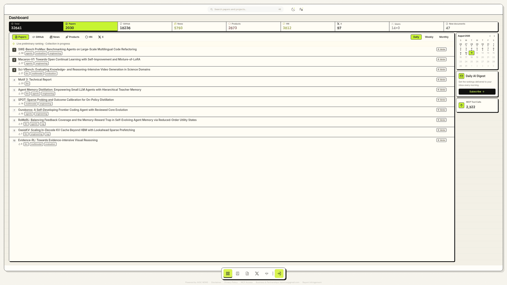
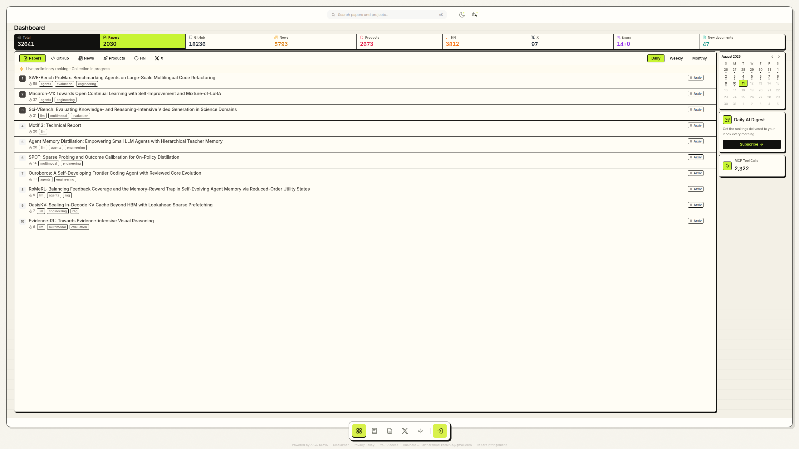
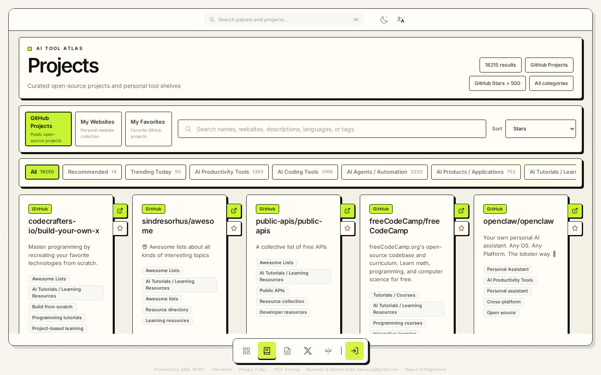
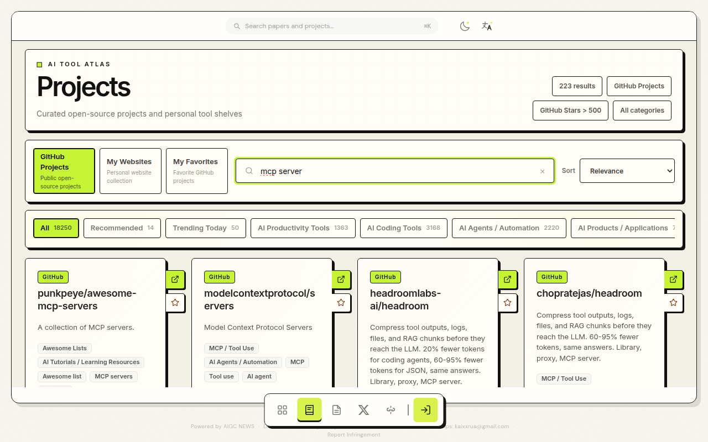

<div align="center">
  
</div>

<p align="center">
  <a href="README.zh-CN.md">简体中文</a> | <strong>English</strong>
</p>

<p align="center">
  <a href="https://aigcnews.cn/mcp?utm_source=github&utm_medium=readme"></a>
  <a href="https://cursor.com/en-US/install-mcp?name=aigc-radar&config=eyJ1cmwiOiJodHRwczovL2FpZ2NuZXdzLmNuL2FwaS9tY3AifQ=="></a>
  <a href="https://aigcnews.cn/mcp?utm_source=github&utm_medium=readme"></a>
</p>

# AIGCNEWS

An AI discovery data platform: continuously indexes arXiv papers, GitHub AI projects, tech news, Product Hunt, and Hacker News, producing daily rankings and research briefs. The same dataset is served through two interfaces:

- **AIGC Radar MCP** — an MCP data interface for agents (flagship)
- **Web Site** — rankings, project library, and briefings for human readers ([aigcnews.cn](https://aigcnews.cn))

## Demo



| Daily Dashboard Rankings | GitHub AI Project Library |
| --- | --- |
|  |  |

| Semantic project search ("mcp server") |
| --- |
|  |

## AIGC Radar MCP (Flagship Interface)

AIGC Radar is the flagship interface of this project: a Streamable HTTP MCP Server that lets MCP clients such as Claude Code query the platform directly, with a built-in MCP-first open-source project discovery and reuse policy (local-first, 500-star admission threshold, limited read-only GitHub fallback). Unlike general-purpose news/hot-topic MCPs, it is an AI-vertical structured index: arXiv papers, a curated and enriched GitHub AI project library (category taxonomy, Chinese/English tags, star-growth snapshots), and multi-source daily/weekly/monthly rankings — hosted, ready to connect, public and read-only.

```text
https://aigcnews.cn/api/mcp
```

Connect from Claude Code:

```bash
claude mcp add --transport http aigc-radar https://aigcnews.cn/api/mcp
```

Any MCP client that supports Streamable HTTP can point directly at this URL; the Web site offers one-click import configs for 9 client types (Cursor, Codex, VS Code, Windsurf, etc.); stdio-only clients can bridge via `npx mcp-remote https://aigcnews.cn/api/mcp`. For self-hosted local development, the endpoint is `http://localhost:8000/api/mcp`.

Public tools (no auth required, all read-only):

| Tool | Purpose |
| --- | --- |
| `search_github_ai_projects` | Local-first search of the curated GitHub AI project library (AI/Agent/MCP/RAG/LLM engineering artifacts) |
| `search_github_projects` | Search non-AI GitHub open-source software and components |
| `search_papers` | arXiv paper search |
| `search_documents` | Cross-source index search (arXiv / GitHub / news / Product Hunt / Hacker News) |
| `get_top_items` | Daily / weekly / monthly ranking snapshots |
| `get_paper_detail` | Details for a single indexed document |
| `get_project_categories` | Project categories with subcategory counts |

Sending `Authorization: Bearer <MCP access token>` additionally unlocks `search_my_project_favorites` (personal favorites search).

On the context side, it provides resources (`aigc-news://dashboard/summary`, `aigc-news://report/latest`, etc.), resource templates, and prompts (`daily_research_brief`, `project_discovery`). For full protocol parameters, the MCP-first policy, and fallback semantics, see [docs/mcp-server.md](docs/mcp-server.md).

## Web Site

A human-readable interface over the same dataset, live at **[aigcnews.cn](https://aigcnews.cn)**: dashboard rankings with a trend radar, the GitHub AI project library (categories / filters / favorites), paper and cross-source indexes, and daily research briefs. Vue 3 + Vite frontend, FastAPI backend, PostgreSQL 16 for relational data.

## Quick Start (Linux / WSL2)

### Prerequisites

| Tool | Version | Notes |
| --- | --- | --- |
| Python | 3.12 | Backend runtime (image pinned by digest to `python:3.12-slim`) |
| Node.js | 22 | Frontend build and tests (matches CI) |
| Docker + Compose | v2 | Infrastructure and production stack orchestration |

### 1) Prepare environment variables

```bash
cp .env.example .env
```

Edit `.env` with your local parameters. **`JWT_SECRET_KEY` must be set to a strong random value** — the application refuses to start if it is missing, equal to the example value, or shorter than 32 characters (see [docs/adr/0001](docs/adr/0001-jwt-secret-rotation-and-startup-guard.md)):

```bash
openssl rand -hex 32
```

### 2) Install dependencies

```bash
python3.12 -m venv backend/.venv
backend/.venv/bin/python -m pip install --upgrade pip
backend/.venv/bin/python -m pip install -r backend/requirements-dev.txt
cd frontend && npm ci && cd ..
```

`requirements-dev.txt` adds pytest / pytest-cov / ruff on top of the locked `requirements.lock`, sharing the same dependency baseline as CI.

### 3) Prepare frontend TLS certificates (self-signed is fine)

The `frontend-web` nginx mounts `frontend/ssl/` as a read-only volume (gitignored; absent on a clean checkout) and fails to start without certificates. For local deployment, generate a self-signed certificate:

```bash
mkdir -p frontend/ssl
openssl req -x509 -newkey rsa:2048 -nodes \
  -keyout frontend/ssl/aigcnews.cn.key \
  -out frontend/ssl/aigcnews.cn_bundle.crt \
  -days 3650 -subj "/CN=aigcnews.cn"
# The hardened frontend-web container (cap_drop: ALL) requires the private key to be owned by root
sudo chown root:root frontend/ssl/*.key && sudo chmod 600 frontend/ssl/*.key
```

### 4) Start the core stack

```bash
scripts/manage_main_stack.sh up
```

This reconciles the core Compose stack (backend API, frontend, PostgreSQL, Redis, Milvus, MinIO, etc.) and waits for all health checks to pass — **a clean checkout runs as-is**. Common subcommands: `config` (validates the orchestration without printing secrets), `status`, `logs`.

> Private deployment extensions (sister services, external orchestration networks, private nginx servers, etc.) are not shipped with the repository; they are injected as an overlay: when the script detects `../aigcnews_private/deploy/docker-compose.private.yml` (overridable via `AIGCNEWS_PRIVATE_COMPOSE`), it is merged in automatically; when absent, the core stack works standalone. See the header comments in `docker/docker-compose.yml` for the mechanism.

### 5) Local development (hot reload outside containers)

```bash
# Backend (reads API_HOST / API_PORT from settings, default 8000)
backend/.venv/bin/python run_server.py

# Frontend (Vite dev server, default 5173)
cd frontend && npm run dev
```

## Ports & Health Checks

| Address | Purpose |
| --- | --- |
| `http://localhost` (80/443) | Frontend site (production domain certificates live in `frontend/ssl/`; keys must be `root:root` mode 600) |
| `http://localhost:5173` | Vite dev server |
| `http://127.0.0.1:8000` | Backend API (loopback-only binding; `/api/live`, `/api/ready` health checks) |
| `http://localhost:8000/api/mcp` | Local MCP endpoint |

Infrastructure (PostgreSQL / Redis / Milvus / MinIO / Attu) is only exposed inside the orchestration network and publishes no ports to the host; the backend reaches it by service name. For ad-hoc host-side debugging use `docker exec <container> ...`; operational details are in [docs/linux-server-boot.md](docs/linux-server-boot.md).

## Testing & Quality Checks

```bash
# Full backend suite (must run from the repository root, same as CI)
backend/.venv/bin/python -m pytest backend/tests -q

# Backend lint
backend/.venv/bin/python -m ruff check backend/app backend/tests --config backend/pyproject.toml

# Frontend: unit tests, type check, lint, build
cd frontend
npm run test:unit
npm run typecheck
npm run lint
npm run build

# Orchestration validation
docker compose -f docker/docker-compose.yml config --quiet
```

Commit messages follow Conventional Commits (`<type>(<scope>): <subject>`, scope required); details in [docs/git-workflow.md](docs/git-workflow.md).

## Directory Structure

```text
backend/            FastAPI app (app/), tests (tests/), migrations (migrations/), locked dependencies
frontend/           Vue 3 + Vite site (src/), nginx config, frontend image
docker/             Compose orchestration (core stack) and backup-drill orchestration (private extensions injected via overlay)
docs/               Project documentation (index in docs/README.md, decision records in docs/adr/)
scripts/            Stack management, migration, backup, and data backfill scripts
.github/workflows/  CI: backend tests, PostgreSQL integration, frontend build & lint, orchestration smoke
.githooks/          commit-msg validation (git config core.hooksPath .githooks)
```

## Architecture & Documentation

- [docs/project-overview.md](docs/project-overview.md) — Project panorama: product, architecture, data, deployment, and engineering status
- [docs/architecture.md](docs/architecture.md) — Current functional architecture (PostgreSQL 16 as the sole relational runtime)
- [docs/mcp-server.md](docs/mcp-server.md) — AIGC Radar MCP protocol parameters and policies
- [docs/README.md](docs/README.md) — Full documentation index (including historical archive annotations)

## License

[AIGCNEWS Source Available License](LICENSE) © 2026 Kaixxrua — free for personal, non-commercial use; commercial use and public deployment require the author's prior written authorization.
