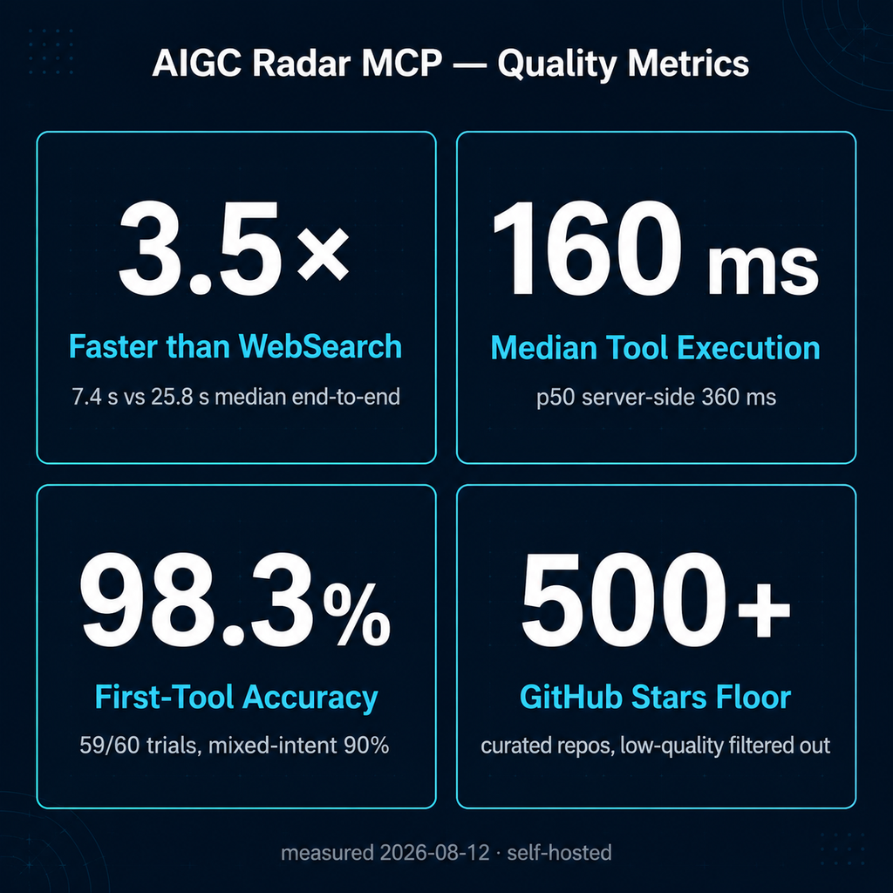

<div align="center">
  
</div>

<p align="center">
  <strong>简体中文</strong> | <a href="README.md">English</a>
</p>

<p align="center">
  <a href="https://aigcnews.cn/mcp?utm_source=github&utm_medium=readme"></a>
  <a href="https://github.com/Kaixxrua/AIGC_NEWS/actions/workflows/contract-baseline.yml"></a>
  <a href="LICENSE"></a>
  <a href="https://cursor.com/en-US/install-mcp?name=aigc-radar&config=eyJ1cmwiOiJodHRwczovL2FpZ2NuZXdzLmNuL2FwaS9tY3AifQ=="></a>
  <a href="https://aigcnews.cn/mcp?utm_source=github&utm_medium=readme"></a>
</p>

# AIGCNEWS

面向工程师、研究者与 AI Agent 的 AI 发现与情报平台：持续索引 arXiv / HuggingFace 论文、GitHub AI 项目、科技新闻、Product Hunt、Hacker News 与 X（Twitter）热点，加工为可浏览的榜单、可检索的项目库与可订阅的简报。同一份数据通过两个入口对外提供：

- **AIGC Radar MCP** —— 面向 Agent 的 MCP 数据接口（旗舰）
- **Web 站点** —— 面向人类读者的榜单、项目库与简报界面（[aigcnews.cn](https://aigcnews.cn)）

## 性能实测

数字先行 —— 以下实测针对后文详述的旗舰接口 [AIGC Radar MCP](#aigc-radar-mcp旗舰接口)：



- **端到端中位比 WebSearch 快 3.5×**（10 组代表性查询，7.4 s 对 25.8 s），测于 2026-08-11
- **MCP 工具执行中位 160 ms**（区间 30–800 ms）；服务端延迟 p50 360 ms / p95 710 ms，测于 2026-08-11
- **工具首选准确率 98.3%**（59/60 次试验：意图明确 100%、混合意图 90%），测于 2026-08-12

<details>
<summary>完整数据表、方法学与复现命令</summary>

服务端延迟，测于 2026-08-11，可用 [scripts/benchmark_mcp_latency.py](scripts/benchmark_mcp_latency.py) 复现（Streamable HTTP JSON-RPC，6 个代表性工具 × 3 轮，共 18 次 `tools/call` 计时）：

| Endpoint | p50 | p95 | 说明 |
| --- | --- | --- | --- |
| 自托管 `http://localhost:8000/api/mcp` | 360 ms | 710 ms | 后端查询处理本身为亚秒级 |

Agent 端到端对比 WebSearch，测于 2026-08-11，可用 [scripts/benchmark_agent_tool_latency.py](scripts/benchmark_agent_tool_latency.py) 复现：headless `claude -p`（claude-opus-4-8，effort low），MCP 指向 `http://127.0.0.1:8000/api/mcp`，wall-clock 从进程启动计到产出完整回答，两侧均要求用不超过两句话作答，10 组不同查询 × 每条路径各 1 次：

| 查询 | AIGC Radar MCP | — 其中工具执行 | WebSearch |
| --- | --- | --- | --- |
| self-hosted LLM observability platform open source | 9.6 s | 802 ms | 13.4 s |
| open source screenshot tool for Windows with rounded corners | 7.7 s | 66 ms | 38.8 s |
| mixture of experts load balancing paper | 6.7 s | 96 ms | 19.8 s |
| Sora video generation model | 6.2 s | 204 ms | 42.4 s |
| trending GitHub repositories this week | 9.4 s | 748 ms | 10.7 s |
| MCP server for database access | 8.7 s | 510 ms | 10.0 s |
| self-hosted photo management like Google Photos | 32.9 s | 41 ms | 31.8 s |
| RLHF reward model overoptimization paper | 7.0 s | 139 ms | 17.4 s |
| top Hacker News stories this month | 6.8 s | 31 ms | 52.2 s |
| Claude Code agent skills | 6.7 s | 178 ms | 54.8 s |
| **中位数** | **7.4 s** | **160 ms** | **25.8 s** |

MCP 在 10 组中有 9 组低于 10 秒，WebSearch 从未低于 9.9 秒——**中位口径快 3.5 倍**。纯 MCP 工具执行（`tool_use` → `tool_result`）中位数 160 ms（30–800 ms）；WebSearch 的搜索在 API 回合内部执行（server-side 工具），客户端无法观测到等价窗口。32.9 s 的 MCP 离群值是模型 API 停顿而非工具耗时（该次工具调用仅 41 ms）——中位数口径天然排除此类波动。

工具选用准确率，测于 2026-08-12，可用 [scripts/eval_mcp_tool_selection.py](scripts/eval_mcp_tool_selection.py) 复现：headless `claude -p`（claude-opus-4-8，effort high），宿主工具与全部 7 个 MCP 工具同时可用；仅当**首个**工具调用命中预期的 AIGC Radar 工具且全程无宿主工具绕行时记为通过：

| 探针组 | 准确率 |
| --- | --- |
| 9 个意图明确探针（1 个 10 次、其余 8 个各 5 次） | **100%**（50/50） |
| 2 个混合意图探针（各 5 次试验） | **90%**（9/10） |
| **总计（11 个探针，60 次试验）** | **98.3%**（59/60） |

明确意图探针在基线跑次保持 100%；改动后复测的未命中全部是基础设施抖动（一次 harness 超时、一次 429 限流重试耗尽、首个助手回合尚未产出），无一例路由错误——表中因此取基线明确意图数据与改动后混合意图数据的组合（同天同 harness）。混合意图提示词明确邀请两类交付物（"以项目为主、论文为辅"）：早期试验中模型会把两个候选工具并行都调，工具描述中的路由规则已彻底消除这一模式——剩余一次未命中是模型把碎片式提示词解读成偏好设置指令、转而用 Bash 写入记忆，属提示词解读分歧而非路由错误。

复现：

```bash
python3 scripts/benchmark_mcp_latency.py --url http://localhost:8000/api/mcp --trials 3
python3 scripts/benchmark_agent_tool_latency.py  # 需要 claude CLI
python3 scripts/eval_mcp_tool_selection.py       # 需要 claude CLI
```

</details>

## 演示


| Dashboard 每日榜单 | GitHub AI 项目库 |
| --- | --- |
|  |  |

| 项目库语义检索（"mcp server"） |
| --- |
|  |

## 功能一览

- **多源榜单 Dashboard** —— 论文 / GitHub / 新闻 / Product Hunt / Hacker News / X 六源同板（日 / 周 / 月），快照可按日期回看，GitHub 热度分不只看总 Stars
- **GitHub AI 项目库** —— 18,000+ 精选项目与工具站，≥500 Stars 准入门槛，中英双语分类与标签，PostgreSQL 关键词 × Milvus 语义混合检索，卡片展示今日 +N Stars，筛选状态同步 URL 可分享
- **论文发现与阅读** —— arXiv / HuggingFace 每日热门论文，站内摘要与原文链接，后台 PDF 图文提取、全文索引和日报总结
- **X 动态** —— 精选时间线 + 按日期快照与静默期，推文中文翻译完整补回 @ 提及
- **智能简报与订阅** —— 各方向日 / 周 / 月报（中英双语）SSE 流式生成，按来源与频率邮件订阅、支持立即送达
- **收藏与私人书架** —— 乐观更新收藏 + 个人标签 + 跨设备同步，提交 URL 自动富化的私人工具书架，公共与私人数据严格隔离
- **账号与管理后台** —— 邮箱验证码 + JWT（空库首启动种子默认管理员，登录后站内免 SMTP 改密），采集监控、模型 Provider 真实连接测试、数据库化 SMTP 面板、爬取与富化队列（重试 / 熔断）

完整功能走查：[docs/project-overview.md](docs/project-overview.md)

## AIGC Radar MCP（旗舰接口）

AIGC Radar 是本项目的旗舰入口：一个 Streamable HTTP MCP Server，让 Claude Code 等 MCP 客户端直接检索平台数据，并内置 MCP-first 的开源项目发现与复用策略（本地优先、500 Stars 准入、限量只读 GitHub fallback）。与通用舆情/热点聚合类 MCP 不同，它是一个 AI 垂直结构化索引：arXiv 论文、精选富化的 GitHub AI 项目库（分类体系、中英标签、星标增长快照）与多源日/周/月榜单，托管即连、公开只读。

```text
https://aigcnews.cn/api/mcp
```

接入 Claude Code：

```bash
claude mcp add --transport http aigc-radar https://aigcnews.cn/api/mcp
```

任何支持 Streamable HTTP 的 MCP 客户端都可以直接指向该 URL；Web 站点内置 9 类客户端（Cursor、Codex、VS Code、Windsurf 等）的一键导入配置；仅支持 stdio 的客户端可经 `npx mcp-remote https://aigcnews.cn/api/mcp` 桥接。自托管本地开发时 endpoint 为 `http://localhost:8000/api/mcp`。

使用 [dsh](https://github.com/deepseek-ai/deepseek-harness)（DeepSeek Harness）的用户可以免去手动配置 MCP，直接安装原生插件 [dsh-aigc-radar](https://github.com/Kaixxrua/dsh-aigc-radar)：走同一个 `/api/mcp` 端点，但结果在 dsh Web UI 渲染为原生搜索卡片，并内置主动复用检查。

```sh
# 推荐：npm 预构建包
dsh plugin --profile web add dsh-aigc-radar

# 可复现：固定已发布版本
dsh plugin --profile web add dsh-aigc-radar@0.2.0

# 源码兜底
dsh plugin --profile web add github:Kaixxrua/dsh-aigc-radar
```

GitHub 安装会现场构建源码；pnpm 构建放行与固定 commit 的细节见[插件 README](https://github.com/Kaixxrua/dsh-aigc-radar#安装)。

MCP 与 `/api/v1` 共用同一配额池：匿名按 IP 每个固定 24 小时窗口 30 次；Free 每个固定 24 小时窗口 60 次、滚动 30 天窗口 1,200 次；VIP 分别为 400 次与 8,000 次。登录档先检查 24 小时 pacing 桶，触发时不会消耗滚动 30 天额度。

公开工具（无需鉴权；除仅追加的采纳回执外全部只读）：

| 工具 | 用途 |
| --- | --- |
| `search_github_ai_projects` | local-first 搜索站内精选 GitHub AI 项目库（AI/Agent/MCP/RAG/LLM 工程产物） |
| `search_github_projects` | 搜索非 AI 的 GitHub 开源软件与组件 |
| `search_papers` | arXiv 论文专搜 |
| `search_documents` | 跨来源（arXiv / GitHub / news / Product Hunt / Hacker News）索引搜索 |
| `get_top_items` | 日 / 周 / 月榜单快照 |
| `get_paper_detail` | 单条索引文档详情 |
| `get_project_categories` | 项目分类与子类计数 |
| `submit_project_adoption` | 采纳回执：检索导致具体决策后上报一次（adopted / reference_only / declined），驱动复用率指标 |

携带 `Authorization: Bearer <MCP access token>` 时额外解锁 `search_my_project_favorites`（个人收藏检索）。登录用户可签发最小权限、可撤销的只读 Token，支持设备标签与有效期 —— 明文仅在创建时展示一次，服务端只保存摘要。

**复用闭环** —— 产品赌注是"做项目的时候，AI 自动发现成熟技术，避免重复造轮子"，闭环端到端打通：确定性触发（[dsh 插件](https://github.com/Kaixxrua/dsh-aigc-radar)监听 `agent/pre-step`、Claude Code `UserPromptSubmit` hook、MCP `instructions` 本身）在 agent 动手写代码之前推它先检索；检索工具返回精选且有 Stars 门槛的项目；agent 随后写一条采纳回执（`submit_project_adoption` 或 `POST /api/projects/adoptions`），记录 adopted / reference_only / declined；回执聚合成复用率指标，见 `GET /api/projects/adoptions/stats`。完整机制、决策语义与 hook 配方：[docs/reuse-loop.md](docs/reuse-loop.md)。

Context 侧提供 resources（`aigc-news://dashboard/summary`、`aigc-news://report/latest` 等）、resource templates 与 prompts（`daily_research_brief`、`project_discovery`）。完整的协议参数、MCP-first 策略与 fallback 语义见 [docs/mcp-server.md](docs/mcp-server.md)。

<details>
<summary>结构化响应样例与 500 Stars 质量门槛</summary>

**结构化 JSON 响应** —— WebSearch 给你链接，AIGC Radar 给你可直接消费的数据。`search_github_ai_projects` 单条记录节选：

```json
{
  "full_name": "rag-web-ui/rag-web-ui",
  "url": "https://github.com/rag-web-ui/rag-web-ui",
  "description_zh": "基于 RAG 的智能对话 Web UI，适合搭建私有知识库问答与文档检索助手。",
  "category_name_zh": "RAG / 知识库",
  "subcategory_name_zh": "文档问答",
  "tags_zh": ["文档问答", "检索增强生成", "知识库", "Web 界面"],
  "tags_en": ["Document Q&A", "RAG", "Knowledge base", "Web UI"],
  "language": "TypeScript",
  "stars": 3257,
  "daily_star_growth": 1,
  "hot_score": 2.5899,
  "pushed_at": "2026-04-06T14:22:58Z",
  "detail_url": "https://aigcnews.cn/projects?q=rag-web-ui%2Frag-web-ui&utm_source=mcp&utm_medium=tool"
}
```

- 中英双语字段：`description_zh` / `tags_zh` / `tags_en` 与双语分类体系，同一索引同时服务中英文检索。
- 质量信号随响应直达：`stars` / `forks` / `daily_star_growth` / `hot_score` / `pushed_at`，无需再调 GitHub API。
- 准入与溯源透明：500 Stars 准入（`min_stars`）、`result_origin` / `fallback_used` 标明结果来源、`attribution` 与 `detail_url` 可回链详情页。

**高质量精选索引** —— 项目库中的每个 GitHub 项目都通过了 **500 Stars 准入门槛**（`min_stars`）才会进入精选环节——玩具项目、停更 fork、低信号仓库从未入库，搜索结果天然高质量，Agent 无需再做二次过滤。WebSearch 没有这道闸门：它按公开网页排名返回，可能混入无人维护或琐碎的仓库，质量判断全部留给使用者。

- 全链路强制：500 Stars 下限同时作用于入库采集与限量只读 GitHub fallback，低于门槛的结果在到达 Agent 之前就被排除。
- 精选而非简单爬取：入库项目附带分类体系、中英双语标签与星标增长快照，排序信号保持新鲜。

</details>

## 架构

```text
数据源（arXiv/HF · GitHub · Techmeme · Product Hunt · HN · X）
  → 抓取与标准化 → 富化（README / PDF 补全、AI 评分、打标、中文描述）
  → PostgreSQL 主写 → 排行快照
  → Milvus 向量索引 · Neo4j 论文图谱 → 缓存失效
  → Dashboard · 项目检索 · 简报 · MCP
```

Vue 3 + TypeScript 前端 · FastAPI 分层单体 · PostgreSQL 16 唯一关系型运行时 · Milvus 向量 + Neo4j 论文图谱 · Redis 缓存 —— 单机 Docker Compose + 进程内调度器（Asia/Shanghai）。完整技术栈表与模块拆解见 [docs/architecture.md](docs/architecture.md)。后端另内置混合 RAG 对话链路（召回、精排、流式、多会话），支撑论文页旁的 AI 对话。

## 快速开始（Linux / WSL2）

需要 Python 3.12 · Node.js 22 · Docker Compose v2。**干净检出即可运行：**

```bash
cp .env.example .env
# 然后编辑 .env：必须设置 JWT_SECRET_KEY（openssl rand -hex 32）——缺失或过弱时应用拒绝启动
python3.12 -m venv backend/.venv && backend/.venv/bin/python -m pip install -r backend/requirements-dev.txt
(cd frontend && npm ci)
# frontend-web 的 nginx 需要证书（自签名即可）；加固容器要求私钥 root:root 600
mkdir -p frontend/ssl && openssl req -x509 -newkey rsa:2048 -nodes -keyout frontend/ssl/aigcnews.cn.key -out frontend/ssl/aigcnews.cn_bundle.crt -days 3650 -subj "/CN=aigcnews.cn"
sudo chown root:root frontend/ssl/*.key && sudo chmod 600 frontend/ssl/*.key
scripts/manage_main_stack.sh up
```

首次运行注意：空库时后端首启动自动种子默认管理员（`admin@aigcnews.internal` / `admin123456`，可用 `DEFAULT_ADMIN_*` 覆盖），没有 SMTP 也能立即登录——登录后请立刻通过站内「修改密码」对话框改密（只需当前密码，免邮件）。注册新用户与找回密码仍需要可用的邮件通道 —— 在 `.env` 配好 `SMTP_*`，或留空 `SMTP_HOST` 用 dev 模式在后端日志打印验证码。TLS 细节、端口与健康检查、热重载开发模式、测试命令与私有 overlay 机制见 [docs/self-hosting.zh-CN.md](docs/self-hosting.zh-CN.md)

## 目录结构

```text
backend/            FastAPI 应用（app/）、测试（tests/）、迁移（migrations/）、依赖锁定
frontend/           Vue 3 + Vite 站点（src/）、nginx 配置、前端镜像
docker/             Compose 编排（核心栈）与备份演练编排（私有扩展经 overlay 注入）
docs/               项目文档（索引见 docs/README.md，决策记录见 docs/adr/）
scripts/            栈管理、迁移、备份与数据回填脚本
.github/workflows/  CI：后端测试、PostgreSQL 集成、前端构建与 lint、编排冒烟
.githooks/          commit-msg 提交信息校验（git config core.hooksPath .githooks）
```

## 文档索引

- [docs/self-hosting.zh-CN.md](docs/self-hosting.zh-CN.md) —— 自托管完整指南：TLS 证书、默认管理员与 SMTP、端口、测试
- [docs/project-overview.md](docs/project-overview.md) —— 项目全景：产品定位、数据源全景与逐模块功能走查
- [docs/architecture.md](docs/architecture.md) —— 架构当前态（开发者向）：分层、API、存储、调度与部署
- [docs/mcp-server.md](docs/mcp-server.md) —— AIGC Radar MCP 协议参数与策略
- [docs/README.md](docs/README.md) —— 全部文档索引（含历史归档标注）

## 数据归属与合规

- **聚合内容不归本项目所有。** 管线呈现的论文、仓库元数据、新闻、Product Hunt / Hacker News 条目与 X 推文，其权利归原作者与平台所有。AIGCNEWS 仅为运行阅读界面存储元数据、摘要与缩略图，不主张任何所有权。参考部署的数据库转储、采集快照与媒体缓存不属于本仓库，亦不许可再分发。
- **X 实现公开。** X（Twitter）的读取、解析与分页 transport 已随本仓库发布，并由默认关闭的 `x_source_enabled` 特性开关门控（见 `backend/app/services/ingestion/sources/x_transport.py`）。真实 X cookie/token、加密凭据行、私有 overlay、代理拓扑、部署运营配置、数据库转储、采集快照与媒体缓存均不包含在仓库中。X 关闭或未配置时采集会安全跳过，其余功能不受影响。
- **自建实例的运营者责任**：启用这些信息源须自行遵守源平台服务条款、robots 协议与适用法律，并妥善保管配置的凭据（cookie/token）。
- **商标。** X、Twitter、WeChat、Product Hunt、Hacker News、arXiv、GitHub、Hugging Face 等名称与标志归各自所有者；本项目仅为指称性使用，不存在隶属或背书关系。
- **内容移除请求**：请提 issue 或联系维护者。完整归属声明见 [NOTICE](NOTICE)。

## 贡献与安全

- [CONTRIBUTING.md](CONTRIBUTING.md) —— 开发环境、提交规范（Conventional Commits，scope 必填）与 PR 要求
- [SECURITY.md](SECURITY.md) —— 支持版本说明与漏洞私下报告渠道
- [CODE_OF_CONDUCT.md](CODE_OF_CONDUCT.md) —— Contributor Covenant 2.1 行为准则
- 测试与质量检查命令（pytest、ruff、Vitest、typecheck、构建、编排校验）：[docs/self-hosting.zh-CN.md#测试](docs/self-hosting.zh-CN.md#测试)

## License

[GNU Affero General Public License v3.0](LICENSE) © 2026 Kaixxrua —— 可自由使用、修改与自托管（含商用）；若将修改版以公网服务形式对外提供，须以 AGPL-3.0 公开其源码。商业授权请联系作者。
