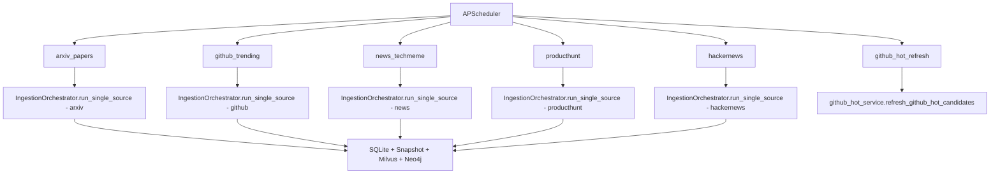

# 架构重构计划书：元数据与排行快照分离 + 多源爬虫任务解耦

> **历史计划 / 已由当前架构取代（2026-07-29）**
>
> 本文是 2026 年 3 月的阶段性重构计划，其中 SQLite、三库写入和待办状态均不代表当前实现，不得据此实施数据库变更。当前架构见 [`../docs/architecture.md`](../docs/architecture.md)；MySQL 最终退役见 [`../docs/mysql-retirement-runbook.md`](../docs/mysql-retirement-runbook.md)。

> 版本: v1.0 | 日期: 2026-03-11 | 状态: 历史归档

---

## 〇、现状分析

### 技术栈

| 层 | 技术 |
|----|------|
| API 框架 | FastAPI (async) |
| 数据库 | SQLite (WAL mode, 纯 SQL, 无 ORM) |
| 向量库 | Milvus |
| 知识图谱 | Neo4j |
| 调度 | APScheduler (AsyncIOScheduler) |
| HTTP 客户端 | httpx / curl_cffi / feedparser |
| LLM | LangChain (model_factory) |

### 现有目录结构（ingestion 模块）

```
backend/app/services/ingestion/
├── __init__.py                  # placeholder
├── pipeline.py                  # 六源并行采集主入口（God Object）
├── content_enricher.py          # 内容丰富（PDF/README/详情页）
├── graph_extractor.py           # LLM 提取知识图谱
├── github_hot_service.py        # GitHub 热度追踪（独立于 pipeline）
├── source_arxiv_mcp.py          # Arxiv 数据源（爬 HF Papers）
├── source_github.py             # GitHub 数据源（API Search，旧版）
├── source_github_mcp.py         # placeholder
├── source_github_trending.py    # GitHub Trending（爬网页）
├── source_hackernews.py         # HN 数据源（Algolia API）
├── source_huggingface.py        # HF 模型（已禁用）
├── source_news.py               # Techmeme RSS
└── source_producthunt.py        # PH 主页爬取
```

### 已完成的工作（阶段一部分）

在本次对话的前半部分，已经完成了快照表的**初步实现**：

1. ✅ `document_rank_snapshots` 表已创建
2. ✅ `upsert_rank_snapshot()` 方法已添加
3. ✅ `pipeline.py` 中已在 `upsert_document()` 后追加快照写入
4. ✅ Dashboard API 已支持 `date` 查询参数

但这些是**最小可行改动**，存在以下问题需要在本次重构中解决：

- pipeline.py 仍是 God Object（530+ 行），六源逻辑全部耦合
- 爬虫没有统一接口，新增数据源需要改 pipeline.py
- snapshot_date 直接取系统时间，无"业务归属日期"概念
- 调度器只有单一 cron job，五源不能独立调度
- 异常隔离不够：一个源的失败可能影响整体

---

## 一、阶段一：数据库快照层完善 (Database Schema & Repository)

### 1.1 目标

完善 `document_rank_snapshots` 表设计，确保"业务归属日期"语义清晰。

### 1.2 Schema 调整

当前表已创建，需确认以下设计：

```sql
CREATE TABLE IF NOT EXISTS document_rank_snapshots (
    id               INTEGER PRIMARY KEY AUTOINCREMENT,
    doc_id           TEXT NOT NULL,           -- 对应 documents.id
    snapshot_date    TEXT NOT NULL,           -- 业务归属日期 YYYY-MM-DD（非爬虫运行时间）
    source_channel   TEXT NOT NULL,           -- huggingface_daily_html 等
    rank_in_period   INTEGER,                -- 榜单排名（1=第一名）
    raw_score        REAL,                   -- 原始热度分
    score            REAL,                   -- AI 评分（预留）
    created_at       TEXT,                   -- 记录创建时间
    UNIQUE(doc_id, snapshot_date, source_channel)
);
CREATE INDEX IF NOT EXISTS idx_snapshots_date_channel
    ON document_rank_snapshots(snapshot_date, source_channel);
```

### 1.3 Repository 层新增方法

| 方法 | 用途 | 状态 |
|------|------|------|
| `upsert_rank_snapshot()` | 写入/更新快照 | ✅ 已完成 |
| `get_snapshot_documents()` | JOIN 查询指定日期排行 | ✅ 已完成 |
| `get_snapshot_dates()` | 返回有快照的日期列表 | ✅ 已完成 |
| `get_snapshot_source_counts()` | 按日期+来源统计快照数量 | 🆕 待新增 |

### 1.4 改动文件

- `backend/app/repositories/sqlite_repo.py` — 新增 `get_snapshot_source_counts()`

---

## 二、阶段二：API 接口改造 (Time Travel API)

### 2.1 目标

Dashboard API 完整支持"日历时光穿梭"，所有列表和统计接口均可按日期查询。

### 2.2 接口变更

| 接口 | 新增参数 | 查询逻辑 | 状态 |
|------|---------|---------|------|
| `GET /dashboard/top` | `date` | 快照表 JOIN → 回退 documents | ✅ 已完成 |
| `GET /dashboard/radar` | `date` | 快照表 JOIN → 回退 documents | ✅ 已完成 |
| `GET /dashboard/summary` | `date` | 快照表 JOIN → 回退 documents | ✅ 已完成 |
| `GET /dashboard/snapshot-dates` | — | 返回可查日期列表 | ✅ 已完成 |
| `GET /dashboard/summary` | — | stats 按日期统计快照数 | 🆕 待增强 |

### 2.3 增强点

- `summary` 接口的 `stats.source_counts` 在传入 `date` 时应返回**该日期的快照统计**（而非全库统计），让前端统计卡片反映历史状态
- 响应中统一携带 `snapshot_date` 字段（✅ 已完成）

### 2.4 改动文件

- `backend/app/api/routes_dashboard.py` — 增强 summary stats 的日期感知逻辑

---

## 三、阶段三：爬虫架构解耦 (Crawler Decoupling)

这是本次重构的**核心难点**。

### 3.1 目标

将 `pipeline.py` 的 God Object 拆分为 5 个独立爬虫模块 + 1 个轻量编排器。

### 3.2 抽象基类设计

```python
# backend/app/services/ingestion/base_crawler.py

from abc import ABC, abstractmethod
from dataclasses import dataclass
from typing import List, Optional

@dataclass
class CrawlResult:
    source: str                    # arxiv / github / news / producthunt / hackernews
    source_channel: str            # huggingface_daily_html 等
    snapshot_date: str             # 业务归属日期 YYYY-MM-DD
    items: List[dict]              # 标准化的 paper/repo/article dict 列表
    error: Optional[str] = None    # 错误信息（None=成功）

class BaseCrawler(ABC):
    """所有数据源爬虫的统一接口。"""

    @property
    @abstractmethod
    def source_name(self) -> str:
        """数据源标识符，如 arxiv / github。"""

    @property
    @abstractmethod
    def supported_periods(self) -> list[str]:
        """支持的周期列表，如 [daily, weekly, monthly]。"""

    @abstractmethod
    def fetch(
        self,
        period: str,
        limit: int,
        target_date: Optional[str] = None,
    ) -> CrawlResult:
        """执行单周期采集，返回标准化结果。

        Args:
            period: daily / weekly / monthly
            limit: 最多返回条数
            target_date: 业务归属日期（YYYY-MM-DD）。
                         爬虫必须用此日期作为 snapshot_date，
                         而不是盲目取系统当前时间。

        Returns:
            CrawlResult，包含标准化数据和可能的错误信息。
            即使发生异常也应返回 CrawlResult(error=str)，不得抛出。
        """

    def fetch_all_periods(
        self,
        limit: int,
        target_date: Optional[str] = None,
    ) -> List[CrawlResult]:
        """采集所有支持的周期，返回结果列表。"""
        results = []
        for period in self.supported_periods:
            result = self.fetch(period=period, limit=limit, target_date=target_date)
            results.append(result)
        return results
```

### 3.3 五个爬虫实现

将现有 `source_*.py` 中的采集逻辑包装为 `BaseCrawler` 子类：

| 爬虫类 | 文件 | 封装对象 | 支持周期 |
|--------|------|---------|---------|
| `ArxivCrawler` | `crawlers/arxiv_crawler.py` | `source_arxiv_mcp.fetch_latest_papers` | daily, weekly, monthly |
| `GitHubCrawler` | `crawlers/github_crawler.py` | `source_github_trending.fetch_github_trending` | daily, weekly, monthly |
| `NewsCrawler` | `crawlers/news_crawler.py` | `source_news.fetch_news_articles` | daily, weekly, monthly |
| `ProductHuntCrawler` | `crawlers/producthunt_crawler.py` | `source_producthunt.fetch_producthunt_products` | daily |
| `HackerNewsCrawler` | `crawlers/hackernews_crawler.py` | `source_hackernews.fetch_hackernews_items` | daily |

### 3.4 业务归属日期 (snapshot_date) 计算规则

```
如果传入了 target_date → 直接使用（回填场景）
否则：
  - Papers (Arxiv)：取 HF 榜单页的实际日期（从 URL 解析）
  - GitHub Trending：取 CST 当天日期（Trending 是实时快照）
  - News (Techmeme)：取 RSS 条目的发布日期
  - ProductHunt：取 CST 当天日期（PH 是当日产品）
  - HackerNews：取 CST 当天日期（HN 是实时热榜）
```

### 3.5 轻量编排器

将 `pipeline.py` 瘦身为纯编排层，不再包含采集逻辑：

```python
# backend/app/services/ingestion/pipeline.py（重构后）

class IngestionOrchestrator:
    """轻量编排器：调度爬虫 → 内容丰富 → 三库写入。"""

    def __init__(self):
        self.crawlers: List[BaseCrawler] = [
            ArxivCrawler(),
            GitHubCrawler(),
            NewsCrawler(),
            ProductHuntCrawler(),
            HackerNewsCrawler(),
        ]

    def run(self, limit=25, top_n=10, target_date=None) -> Dict[str, int]:
        # 1. 并行调度所有爬虫
        # 2. 逐源内容丰富
        # 3. 逐源写入 SQLite + 快照 + Milvus + Neo4j
        # 4. 后台 PDF 补全
        ...

    def run_single_source(self, source_name, ...) -> int:
        """独立运行单个数据源（供细粒度调度使用）。"""
        ...
```

### 3.6 异常隔离策略

```
每个 BaseCrawler.fetch() 内部 try/except，异常只记录日志
编排器层面：任何一个 CrawlResult.error != None 只记录 warning，继续下一个源
三库写入（SQLite/Milvus/Neo4j）各自独立 try/except
```

### 3.7 重构后目录结构

```
backend/app/services/ingestion/
├── __init__.py
├── base_crawler.py              # 🆕 抽象基类 + CrawlResult
├── crawlers/                    # 🆕 五个独立爬虫
│   ├── __init__.py
│   ├── arxiv_crawler.py         # 封装 source_arxiv_mcp
│   ├── github_crawler.py        # 封装 source_github_trending
│   ├── news_crawler.py          # 封装 source_news
│   ├── producthunt_crawler.py   # 封装 source_producthunt
│   └── hackernews_crawler.py    # 封装 source_hackernews
├── pipeline.py                  # 🔄 瘦身为 IngestionOrchestrator
├── content_enricher.py          # 保持不变
├── graph_extractor.py           # 保持不变
├── github_hot_service.py        # 保持不变
├── source_arxiv_mcp.py          # 保留（被 crawler 调用的底层实现）
├── source_github.py             # 保留（被 github_hot_service 调用）
├── source_github_trending.py    # 保留（被 crawler 调用的底层实现）
├── source_hackernews.py         # 保留
├── source_huggingface.py        # 保留（已禁用）
├── source_news.py               # 保留
└── source_producthunt.py        # 保留
```

> **设计原则**：`source_*.py` 是底层数据获取库（纯函数，无副作用），`crawlers/*.py` 是带标准接口的爬虫包装器（处理异常、计算 snapshot_date、标准化输出）。两层分离，避免破坏已有逻辑。

---

## 四、阶段四：智能调度中心 (Smart Scheduler)

### 4.1 目标

将现有单一 cron job 拆分为多任务、多频率的独立调度。

### 4.2 调度配置

```python
# backend/app/core/scheduler.py（重构后）

SCHEDULE_CONFIG = [
    # ── 高频：实时热榜类 ──
    {
        "id": "github_trending",
        "source": "github",
        "cron": {"hour": "6,10,14,18,22", "minute": 0},  # 每 4 小时
        "desc": "GitHub Trending 热榜采集",
    },
    {
        "id": "hackernews",
        "source": "hackernews",
        "cron": {"hour": "7,11,15,19,23", "minute": 30},  # 每 4 小时（错开）
        "desc": "Hacker News AI 热帖采集",
    },
    {
        "id": "producthunt",
        "source": "producthunt",
        "cron": {"hour": "10,16", "minute": 0},  # 每天 2 次
        "desc": "Product Hunt 新品采集",
    },
    # ── 低频：编辑精选类 ──
    {
        "id": "arxiv_papers",
        "source": "arxiv",
        "cron": {"hour": "9,15", "minute": 30},  # JST 9:30 + 15:00
        "desc": "HuggingFace Papers 论文采集",
    },
    {
        "id": "news_techmeme",
        "source": "news",
        "cron": {"hour": "8,12,18", "minute": 0},  # 每天 3 次
        "desc": "Techmeme 科技新闻采集",
    },
    # ── GitHub 热度快照（独立于 Trending） ──
    {
        "id": "github_hot_refresh",
        "source": "github_hot",
        "cron": {"hour": 2, "minute": 0},  # 每天凌晨 2:00
        "desc": "GitHub 热度快照刷新",
    },
]
```

### 4.3 调度架构



### 4.4 关键设计

1. **每个任务独立线程池运行**（`asyncio.to_thread`），互不阻塞
2. **Misfire 容忍**：`misfire_grace_time=7200`（2 小时），确保服务重启后追赶执行
3. **同源防重入**：使用 APScheduler 的 `max_instances=1`，防止同一源的 job 重叠执行
4. **保留 `run_smart_ingestion()` 兼容入口**：仍可手动调用全量采集
5. **API 手动触发**：保留 `/ops/trigger-ingestion` 接口，支持按源触发

### 4.5 改动文件

- `backend/app/core/scheduler.py` — 重构为多任务调度
- `backend/app/services/ingestion/pipeline.py` — 新增 `run_single_source()` 方法

---

## 五、整体数据流（重构后）

```mermaid
graph TB
    subgraph Scheduler
        S1[Cron: arxiv 9:30/15:00]
        S2[Cron: github 每4h]
        S3[Cron: news 每6h]
        S4[Cron: producthunt 每12h]
        S5[Cron: hackernews 每4h]
    end

    subgraph Crawlers
        C1[ArxivCrawler.fetch]
        C2[GitHubCrawler.fetch]
        C3[NewsCrawler.fetch]
        C4[ProductHuntCrawler.fetch]
        C5[HackerNewsCrawler.fetch]
    end

    subgraph Orchestrator
        O1[content_enricher]
        O2[_ingest_documents]
    end

    subgraph Storage
        DB1[(SQLite documents)]
        DB2[(SQLite rank_snapshots)]
        DB3[(Milvus vectors)]
        DB4[(Neo4j graph)]
    end

    subgraph API
        A1[/dashboard/summary?date=2026-03-10&period=daily]
    end

    S1 --> C1
    S2 --> C2
    S3 --> C3
    S4 --> C4
    S5 --> C5

    C1 --> O1
    C2 --> O1
    C3 --> O1
    C4 --> O1
    C5 --> O1

    O1 --> O2
    O2 --> DB1
    O2 --> DB2
    O2 --> DB3
    O2 --> DB4

    A1 --> DB2
    DB2 -.JOIN.-> DB1
```

---

## 六、实施顺序与风险控制

### 推荐实施顺序

| 阶段 | 依赖 | 风险等级 | 说明 |
|------|------|---------|------|
| 阶段一 | 无 | 🟢 低 | Schema 和 Repository 层改动，已大部分完成 |
| 阶段二 | 阶段一 | 🟢 低 | API 层改动，已大部分完成，需增强 stats |
| 阶段三 | 阶段一 | 🟡 中 | 核心重构，需保证不破坏现有 source_*.py |
| 阶段四 | 阶段三 | 🟡 中 | 调度配置变更，需充分测试各源独立运行 |

### 风险控制

1. **阶段三的兼容策略**：`source_*.py` 不做任何修改，`crawlers/*.py` 只是包装层。旧的 `pipeline.py` 中的 `run_ingestion_pipeline()` 保留为兼容入口。
2. **逐源上线**：可以先改造 1 个爬虫（如 Arxiv），验证通过后再批量改造其余 4 个。
3. **回滚方案**：所有 crawler 包装器如果出错，编排器自动 fallback 到旧的 `fetch_*` 函数直接调用。

---

## 七、文件变更清单（汇总）

| 文件 | 操作 | 阶段 |
|------|------|------|
| `backend/app/repositories/sqlite_repo.py` | 修改（新增 `get_snapshot_source_counts`） | 一 |
| `backend/app/api/routes_dashboard.py` | 修改（增强 stats 日期感知） | 二 |
| `backend/app/services/ingestion/base_crawler.py` | 🆕 新建 | 三 |
| `backend/app/services/ingestion/crawlers/__init__.py` | 🆕 新建 | 三 |
| `backend/app/services/ingestion/crawlers/arxiv_crawler.py` | 🆕 新建 | 三 |
| `backend/app/services/ingestion/crawlers/github_crawler.py` | 🆕 新建 | 三 |
| `backend/app/services/ingestion/crawlers/news_crawler.py` | 🆕 新建 | 三 |
| `backend/app/services/ingestion/crawlers/producthunt_crawler.py` | 🆕 新建 | 三 |
| `backend/app/services/ingestion/crawlers/hackernews_crawler.py` | 🆕 新建 | 三 |
| `backend/app/services/ingestion/pipeline.py` | 修改（瘦身 + 新增 `run_single_source`） | 三 |
| `backend/app/core/scheduler.py` | 修改（多任务调度） | 四 |
