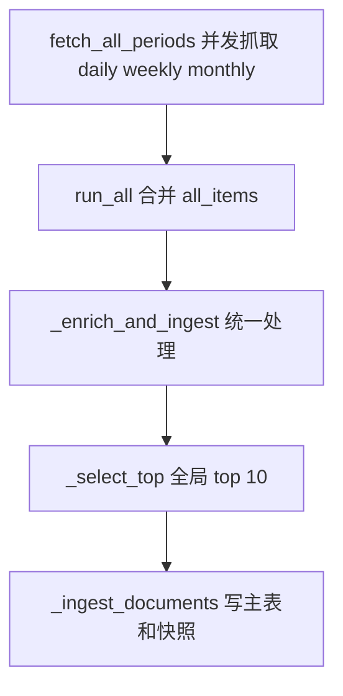
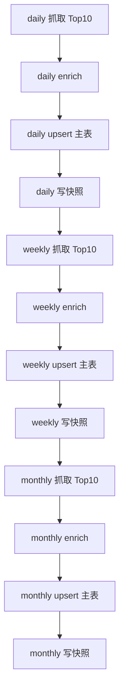

# 主表去重 + 布尔字段标记周期 技术方案

> **历史计划 / 已由当前架构取代（2026-08-03）**
>
> 本文是 2026 年 3 月基于 MySQL/SQLite 时代的技术方案，文中引用的 `backend/app/repositories/mysql_repo.py`、三库写入路径与相关行号均已不存在，不得据此实施任何变更。当前架构见 [`../docs/architecture.md`](../docs/architecture.md)；MySQL 最终退役见 [`../docs/mysql-retirement-runbook.md`](../docs/mysql-retirement-runbook.md)。

---

## 0. 背景与目标

当前问题发生在 [`IngestionOrchestrator.run_all()`](backend/app/services/ingestion/pipeline.py:533) 与 [`BaseCrawler.fetch_all_periods()`](backend/app/services/ingestion/base_crawler.py:156) 的组合流程中：

- 各源的 daily、weekly、monthly 结果先被汇总到同一列表
- 随后统一进入 [`_enrich_and_ingest()`](backend/app/services/ingestion/pipeline.py:395)
- 在 [`_select_top()`](backend/app/services/ingestion/pipeline.py:204) 中仅按全局 `top_n=10` 截断
- 导致月榜高分条目挤占日榜、周榜名额
- 后续 [`_ingest_documents()`](backend/app/services/ingestion/pipeline.py:255) 和 dashboard 查询看到的实际上只剩 monthly 数据

该问题对 [`arxiv`](backend/app/services/ingestion/crawlers/arxiv_crawler.py) 与 [`github`](backend/app/services/ingestion/crawlers/github_crawler.py) 影响最明显，因为这两个来源天然存在三周期排行榜，且不同周期原始热度数值不可直接横向比较。

本方案采用用户指定的目标架构：

1. 主表按 URL 去重
2. 主表增加 `in_daily`、`in_weekly`、`in_monthly` 三个布尔字段
3. [`_doc_id()`](backend/app/services/ingestion/pipeline.py:63) 去除 `source_channel`
4. 采集改为按周期串行处理，避免跨周期相互挤压
5. 榜单查询继续以 [`document_rank_snapshots`](backend/app/repositories/mysql_repo.py:153) 为事实来源，主表布尔字段仅作辅助标记与运营检索

---

## 1. 数据库 Schema 变更

### 1.1 `documents` 表当前问题

当前 [`documents`](backend/app/repositories/mysql_repo.py:57) 表的关键特征：

- 主键为 `id`
- 保存单值 [`source_channel`](backend/app/repositories/mysql_repo.py:60)
- 未对 [`url`](backend/app/repositories/mysql_repo.py:62) 建唯一约束
- 不具备多周期归属表达能力

在新方案下，同一篇文章会同时出现在 daily、weekly、monthly 多个榜单中，因此：

- 单值 `source_channel` 无法完整表达多周期归属
- 仅凭 `id` 做 upsert 不足以满足历史数据迁移和 URL 去重要求
- 需要显式布尔位表达是否属于三个周期

### 1.2 推荐 ALTER TABLE SQL

建议按以下顺序执行变更：

```sql
ALTER TABLE documents
    ADD COLUMN in_daily TINYINT(1) NOT NULL DEFAULT 0 AFTER source_channel,
    ADD COLUMN in_weekly TINYINT(1) NOT NULL DEFAULT 0 AFTER in_daily,
    ADD COLUMN in_monthly TINYINT(1) NOT NULL DEFAULT 0 AFTER in_weekly;

ALTER TABLE documents
    ADD UNIQUE KEY uq_documents_url (url(768));

ALTER TABLE documents
    ADD INDEX idx_documents_source_period_flags (source, in_daily, in_weekly, in_monthly);
```

如果线上库中存在空 URL 或超长 URL 历史脏数据，应先清洗再加唯一索引。更稳妥的执行步骤为：

```sql
SELECT url, COUNT(*) AS cnt
FROM documents
WHERE COALESCE(TRIM(url), '') <> ''
GROUP BY url
HAVING cnt > 1;
```

确认重复 URL 已处理后，再执行唯一索引创建。

### 1.3 三个布尔字段语义

- `in_daily=1`：该文档在某次采集结果中进入 daily 榜单
- `in_weekly=1`：该文档在某次采集结果中进入 weekly 榜单
- `in_monthly=1`：该文档在某次采集结果中进入 monthly 榜单

默认值均应为 `0`，原因：

- 默认状态必须表示 未出现在任何榜单
- 历史数据迁移前，所有旧记录都应保持中性状态，避免误判
- 新采集流程在入库时按当前周期将对应字段置为 `1`

注意：这三个字段表达的是 文档是否属于该周期类别，不是某一天榜单的历史事实。历史事实仍由 [`document_rank_snapshots`](backend/app/repositories/mysql_repo.py:383) 承担。

### 1.4 `document_rank_snapshots` 表是否需要改动

结论：**不需要结构性改表，保留现有 Schema 即可。**

依据如下：

- 当前 [`document_rank_snapshots`](backend/app/repositories/mysql_repo.py:153) 已使用 `doc_id + snapshot_date + source_channel` 唯一约束
- 该唯一键天然支持 同一文档在同一天写入多个周期快照
- dashboard 当前的 [`_get_docs_for_date()`](backend/app/api/routes_dashboard.py:523) 本身就是按 `snapshot_date + source_channel` 精确查询
- 真正的问题不是快照表设计错误，而是上游采集阶段把多周期结果过早合并并全局截断

因此快照层仅需同步适配新的 `doc_id` 生成方式与新的串行入库流程，无需新增字段。

### 1.5 是否保留 `source_channel`

建议：

- **保留 [`documents.source_channel`](backend/app/repositories/mysql_repo.py:60) 字段，但语义弱化为 last_seen_channel**
- 文档中明确说明：主表不再依赖它表达完整周期归属
- 真正的多周期归属由 `in_daily`、`in_weekly`、`in_monthly` 表达
- 真正的历史榜单事实由 [`document_rank_snapshots`](backend/app/repositories/mysql_repo.py:153) 表达

这样可以减少大面积联动修改，并保留部分兼容性。

---

## 2. `_doc_id()` 改造

### 2.1 当前逻辑

当前 [`_doc_id()`](backend/app/services/ingestion/pipeline.py:63) 将 `source_channel` 纳入哈希输入：

- arxiv：`arxiv_id + source_channel`
- github：`full_name + source_channel`
- 其他：`url/title + source_channel`

其直接后果是：

- 同一篇文章仅因榜单周期不同就生成不同 `doc_id`
- 主表会出现 daily、weekly、monthly 三份重复记录
- 快照表中的 `doc_id` 也被迫与周期绑定
- 任何主表层的周期汇总都无法可靠进行

### 2.2 目标逻辑

目标是让同一篇文章跨周期得到相同 `doc_id`。

推荐新逻辑：

1. arxiv：`arxiv:{arxiv_id}`
2. github：`github:{full_name}`
3. 通用优先：标准化后的 `url`
4. 最后兜底：`title`

可表达为：

```python
def _doc_id(paper: dict) -> str:
    source = paper.get('source', '')

    arxiv_id = paper.get('arxiv_id')
    if arxiv_id:
        return md5(f'arxiv:{arxiv_id}')

    if source == 'github':
        key = paper.get('full_name') or paper.get('url') or paper.get('title') or str(paper)
        return md5(f'github:{key}')

    key = paper.get('url') or paper.get('title') or str(paper)
    return md5(key)
```

核心原则是：**同一内容实体不因 `source_channel` 变化而变化。**

### 2.3 对已有数据的影响

影响分两层：

#### 主表层

旧数据中，同一 URL 可能存在多个不同 `id`：

- `doc_id(url + daily_channel)`
- `doc_id(url + weekly_channel)`
- `doc_id(url + monthly_channel)`

改造后，这些记录都应该收敛为一条主记录。

#### 快照层

旧快照表中的 `doc_id` 仍引用旧主键。如果直接切换新 [`_doc_id()`](backend/app/services/ingestion/pipeline.py:63) 而不处理旧数据：

- 新快照会写入新 `doc_id`
- 旧快照仍指向旧 `doc_id`
- [`get_snapshot_documents()`](backend/app/repositories/mysql_repo.py:421) 做 JOIN 时将出现历史数据割裂

### 2.4 迁移策略

推荐分两种路径，在方案中以 **全量重采集** 为主推：

#### 路径 A：清空后重新采集，推荐

适用条件：当前线上数据量可接受、历史榜单不要求保真。

步骤：

1. 停止定时采集任务
2. 执行 Schema 变更
3. 清空 [`documents`](backend/app/repositories/mysql_repo.py:57) 与 [`document_rank_snapshots`](backend/app/repositories/mysql_repo.py:153)
4. 部署新逻辑
5. 重新跑 daily、weekly、monthly 全量采集

优点：

- 实施简单
- 不需要维护旧 `doc_id -> 新 doc_id` 映射
- 避免脏数据残留和 JOIN 断链

缺点：

- 历史榜单快照会丢失

#### 路径 B：保留历史数据并迁移，备选

步骤：

1. 先离线扫描 [`documents`](backend/app/repositories/mysql_repo.py:57)
2. 以 URL 为主键聚合同一内容的多条旧记录
3. 计算新 `doc_id`
4. 选一条记录作为保留主记录，合并：
   - `raw_score` 取最大或最新
   - `score` 取最新
   - `in_daily/in_weekly/in_monthly` 按旧 `source_channel` 回填
   - `summary` 保留最长非空值
5. 更新 [`document_rank_snapshots.doc_id`](backend/app/repositories/mysql_repo.py:155) 指向新 `doc_id`
6. 删除冗余旧主记录

该路径实现复杂，且需要严格事务控制，因此仅建议在必须保留历史数据时使用。

### 2.5 推荐结论

文档中应明确：

- **首选策略是清空 [`documents`](backend/app/repositories/mysql_repo.py:57) 与 [`document_rank_snapshots`](backend/app/repositories/mysql_repo.py:153) 后重新采集**
- 如果业务必须保留历史榜单，再单独做一次离线迁移脚本

---

## 3. 采集管道改造

涉及主文件：[`pipeline.py`](backend/app/services/ingestion/pipeline.py) 与 [`base_crawler.py`](backend/app/services/ingestion/base_crawler.py)

### 3.1 现状问题定位

当前链路如下：



问题根因不在 enrich 或 snapshot，而在 [`run_all()`](backend/app/services/ingestion/pipeline.py:533) 与 [`fetch_all_periods()`](backend/app/services/ingestion/base_crawler.py:156) 之间把多周期结果过早汇总。

### 3.2 目标流程

目标改为 每个周期独立完成 筛选、富化、入库、快照。



### 3.3 `run_all()` 从并行改为串行的具体流程

建议将 [`IngestionOrchestrator.run_all()`](backend/app/services/ingestion/pipeline.py:533) 改为：

1. 仍然按数据源遍历
2. 对每个数据源，不再调用返回全量聚合结果的 [`fetch_all_periods()`](backend/app/services/ingestion/base_crawler.py:156) 直接做总合并
3. 而是按 `supported_periods` 顺序逐个执行：
   - `daily`
   - `weekly`
   - `monthly`
4. 每个周期拿到 [`CrawlResult`](backend/app/services/ingestion/base_crawler.py:32) 后，立刻进入独立 `_enrich_and_ingest_period()` 流程
5. 本周期处理完成后再进入下一周期

推荐新增一个更清晰的编排方法，例如：

- [`IngestionOrchestrator._process_period_result()`](backend/app/services/ingestion/pipeline.py)
- 或拆分为 [`_enrich_and_ingest_period()`](backend/app/services/ingestion/pipeline.py)

这样 [`fetch_all_periods()`](backend/app/services/ingestion/base_crawler.py:156) 可以保留为工具函数，但 [`run_all()`](backend/app/services/ingestion/pipeline.py:533) 不再依赖它的聚合语义。

### 3.4 每个周期独立走 `_enrich_and_ingest` 的详细步骤

推荐每个周期执行以下固定步骤：

1. 调用对应 crawler 的 [`fetch()`](backend/app/services/ingestion/base_crawler.py:113)
2. 对该周期结果单独执行 [`_select_top()`](backend/app/services/ingestion/pipeline.py:204)
3. 为入围条目补充：
   - `source_channel`
   - `period`
   - `in_daily/in_weekly/in_monthly` 对应标记
   - `rank_in_period`
4. 执行 [`_apply_existing_summary_short_circuit()`](backend/app/services/ingestion/pipeline.py:161)
5. 执行 [`enrich_papers()`](backend/app/services/ingestion/content_enricher.py)
6. 调用改造后的 [`_ingest_documents()`](backend/app/services/ingestion/pipeline.py:255)
7. 在入库层内部：
   - 主表按 URL upsert
   - 快照表按 `doc_id + snapshot_date + source_channel` upsert
8. 若来源为 arxiv，再统一收集本周期 `pdf_pending`，最后启动后台 PDF 补全

### 3.5 URL 去重逻辑

#### 判断时机

判断应发生在 **入库层**，而不是 crawler 层或 pipeline 编排层。

原因：

- crawler 只负责抓取，不应感知数据库状态
- pipeline 负责编排，但不应承担持久化规则
- 去重规则属于 repository / ingest persistence concern

#### 实现位置

建议在 [`MySQLRepository.upsert_document()`](backend/app/repositories/mysql_repo.py:180) 对应的主表写入逻辑升级为 **按 URL 唯一键 upsert**。

即：

- `INSERT` 时写入新文档
- 若命中 `uq_documents_url`，则走 `ON DUPLICATE KEY UPDATE`
- 同时更新：
  - `title`
  - `summary`
  - `published_date`
  - `raw_score`
  - `score`
  - `source_channel`
  - `rank_in_period`
  - `in_daily`
  - `in_weekly`
  - `in_monthly`

关键点：布尔字段更新必须是 OR 语义，而不是覆盖语义。

建议 SQL 语义类似：

```sql
in_daily = GREATEST(in_daily, VALUES(in_daily)),
in_weekly = GREATEST(in_weekly, VALUES(in_weekly)),
in_monthly = GREATEST(in_monthly, VALUES(in_monthly))
```

这样先写 daily 后写 weekly，不会把 daily 标记冲掉。

### 3.6 布尔字段在哪个环节设置

结论：**在 pipeline 层计算，在 repository 入库层落盘。**

不建议放在 crawler 层，原因：

- crawler 只知道抓到了哪个 period，不应理解主表 Schema
- 一旦存储模型变化，crawler 会被迫跟着改，耦合过高

推荐做法：

- 在 [`_enrich_and_ingest()`](backend/app/services/ingestion/pipeline.py:395) 或新增的 period 专用方法中，根据当前 `period` 给 paper 注入：
  - `in_daily`
  - `in_weekly`
  - `in_monthly`
- 到 [`_ingest_documents()`](backend/app/services/ingestion/pipeline.py:255) 时，原样传入 [`upsert_document()`](backend/app/repositories/mysql_repo.py:180)

例如：

- daily 批次：`1,0,0`
- weekly 批次：`0,1,0`
- monthly 批次：`0,0,1`

### 3.7 `_ingest_documents()` 改造点

当前 [`_ingest_documents()`](backend/app/services/ingestion/pipeline.py:255) 的问题是主表主键仍完全依赖 [`_doc_id()`](backend/app/services/ingestion/pipeline.py:63)，且没有 URL 唯一约束语义。

建议改造点：

1. 传入布尔字段
2. 明确将 `source_channel` 视为本次命中的 channel，而不是主表唯一身份
3. 调用 repository 时支持 URL 唯一键 upsert
4. 快照写入继续使用当前批次的 `source_channel`
5. 若数据库返回的是已存在 URL 对应的旧记录主键，后续 snapshot 应写入最终统一后的 `doc_id`

这一点意味着 repository 层最好提供如下能力之一：

- `upsert_document()` 返回最终生效的 `doc_id`
- 或新增 `resolve_document_id_by_url()` 辅助查询

推荐前者，职责更闭环。

### 3.8 `BaseCrawler.fetch_all_periods()` 是否要改

结论：**建议轻改，不作为主方案核心。**

当前 [`fetch_all_periods()`](backend/app/services/ingestion/base_crawler.py:156) 做了两件事：

1. 并发抓取全部周期
2. 在每个 [`CrawlResult`](backend/app/services/ingestion/base_crawler.py:32) 内部做 Top-N 裁剪

新方案下问题不在单周期 Top-N，而在上层合并逻辑。因此建议：

- 可以保留该方法，供其他调用方复用
- 但 [`run_all()`](backend/app/services/ingestion/pipeline.py:533) 不再以它作为全量聚合入口
- 如需进一步降低歧义，可重命名或注释强调：该方法返回的是 分周期结果列表，不应用于跨周期合并后再次全局截断

---

## 4. 查询层改造

涉及核心函数：[`_get_docs_for_date()`](backend/app/api/routes_dashboard.py:523)

用户已指定推荐路径：**继续使用 [`document_rank_snapshots`](backend/app/repositories/mysql_repo.py:153) 作为榜单查询事实来源，主表布尔字段仅作辅助标记。**

### 4.1 当前 `_get_docs_for_date()` 是否需要修改

结论：**需要小幅修改，但无需推翻重写。**

当前 [`_get_docs_for_date()`](backend/app/api/routes_dashboard.py:523) 已经具备以下优点：

- 按 `snapshot_date + source_channel` 精确查快照
- 日/周/月榜逻辑物理隔离
- 单来源与全来源查询路径清晰

因此主逻辑可以保留。

需要调整的点主要有两类：

#### 1. 注释与语义同步

需在文档和代码中说明：

- dashboard 榜单以快照表为准
- [`documents`](backend/app/repositories/mysql_repo.py:57) 上的 `in_daily/in_weekly/in_monthly` 不是榜单主查询依据
- [`documents.source_channel`](backend/app/repositories/mysql_repo.py:60) 只是最新命中渠道，不再代表唯一归属

#### 2. 兼容新 `doc_id`

只要完成历史清空重采集，当前 [`get_snapshot_documents()`](backend/app/repositories/mysql_repo.py:421) 的 JOIN 逻辑就无需改 SQL。

如果执行的是保留历史迁移路径，则必须确保 [`document_rank_snapshots.doc_id`](backend/app/repositories/mysql_repo.py:155) 已同步更新，否则查询会断链。

### 4.2 如果改用主表布尔字段查询，SQL 应该怎么写

虽然本方案不推荐它作为主路径，但文档中应给出备选 SQL，便于后续分析。

#### 查询 daily 榜单

```sql
SELECT id, source, title, url, summary, published_date,
       score, raw_score, rank_in_period, created_at
FROM documents
WHERE in_daily = 1
  AND source = %s
ORDER BY raw_score DESC, rank_in_period ASC
LIMIT %s;
```

#### 查询 weekly 榜单

```sql
SELECT id, source, title, url, summary, published_date,
       score, raw_score, rank_in_period, created_at
FROM documents
WHERE in_weekly = 1
ORDER BY raw_score DESC, rank_in_period ASC
LIMIT %s;
```

但它有天然缺陷：

- 无法表达 指定日期 的历史榜单
- 无法区分 同一文档在不同日期的排名变化
- `rank_in_period` 只会保存最后一次 upsert 的值，历史会被覆盖

因此布尔字段只适合：

- 当前库内内容分类过滤
- 运营后台辅助筛选
- 调试检查周期覆盖率

不适合替代榜单事实查询。

### 4.3 如果继续用快照表，快照写入逻辑如何同步适配

这是本方案的推荐路径。

需要保证以下约束：

1. 每个周期单独调用 [`_ingest_documents()`](backend/app/services/ingestion/pipeline.py:255)
2. 该批次每条 paper 都携带正确 `source_channel`
3. [`upsert_rank_snapshot()`](backend/app/repositories/mysql_repo.py:383) 继续写入：
   - `doc_id`
   - `snapshot_date`
   - `source_channel`
   - `rank_in_period`
   - `raw_score`
   - `score`
4. 因为 [`_doc_id()`](backend/app/services/ingestion/pipeline.py:63) 已去掉 `source_channel`，同一文章在 daily、weekly、monthly 会共享同一 `doc_id`
5. 但由于唯一键仍是 `doc_id + snapshot_date + source_channel`，三周期快照仍能并存

这正是该模型的优势：

- 主表按实体去重
- 快照表按 榜单事实 去重
- 两层职责清晰，不互相污染

### 4.4 推荐结论

dashboard 层建议保持当前查询范式：

- [`routes_dashboard.py`](backend/app/api/routes_dashboard.py) 继续查 [`document_rank_snapshots`](backend/app/repositories/mysql_repo.py:153)
- 主表布尔字段不进入主榜单 SQL
- 仅在需要调试、统计覆盖率或后台筛选时使用布尔字段

---

## 5. 影响范围清单

以下为建议修改范围与风险等级。

| 文件 | 函数或区域 | 修改内容 | 风险 |
|---|---|---|---|
| [`backend/app/repositories/mysql_repo.py`](backend/app/repositories/mysql_repo.py) | [`_init_schema()`](backend/app/repositories/mysql_repo.py:54) | 为 `documents` 增加布尔字段与 URL 唯一索引 | 高 |
| [`backend/app/repositories/mysql_repo.py`](backend/app/repositories/mysql_repo.py) | [`upsert_document()`](backend/app/repositories/mysql_repo.py:180) | 改为 URL 唯一键 upsert，布尔字段按 OR 更新，必要时返回最终 `doc_id` | 高 |
| [`backend/app/repositories/mysql_repo.py`](backend/app/repositories/mysql_repo.py) | [`get_snapshot_documents()`](backend/app/repositories/mysql_repo.py:421) | 主要更新注释与兼容性验证，SQL 基本可不动 | 低 |
| [`backend/app/services/ingestion/pipeline.py`](backend/app/services/ingestion/pipeline.py) | [`_doc_id()`](backend/app/services/ingestion/pipeline.py:63) | 去除 `source_channel` 参与哈希 | 高 |
| [`backend/app/services/ingestion/pipeline.py`](backend/app/services/ingestion/pipeline.py) | [`_paper_identity_keys()`](backend/app/services/ingestion/pipeline.py:133) | 适配新 `doc_id` 和 URL 去重优先级 | 中 |
| [`backend/app/services/ingestion/pipeline.py`](backend/app/services/ingestion/pipeline.py) | [`_ingest_documents()`](backend/app/services/ingestion/pipeline.py:255) | 传递布尔字段、处理统一 `doc_id`、快照按周期写入 | 高 |
| [`backend/app/services/ingestion/pipeline.py`](backend/app/services/ingestion/pipeline.py) | [`_enrich_and_ingest()`](backend/app/services/ingestion/pipeline.py:395) 或新增周期方法 | 改为单周期处理入口 | 高 |
| [`backend/app/services/ingestion/pipeline.py`](backend/app/services/ingestion/pipeline.py) | [`run_single_source()`](backend/app/services/ingestion/pipeline.py:470) | 改为逐周期串行处理，避免聚合后统一 Top-N | 高 |
| [`backend/app/services/ingestion/pipeline.py`](backend/app/services/ingestion/pipeline.py) | [`run_all()`](backend/app/services/ingestion/pipeline.py:533) | 改为逐源逐周期串行编排 | 高 |
| [`backend/app/services/ingestion/base_crawler.py`](backend/app/services/ingestion/base_crawler.py) | [`fetch_all_periods()`](backend/app/services/ingestion/base_crawler.py:156) | 弱化聚合入口语义，必要时仅保留辅助用途 | 中 |
| [`backend/app/api/routes_dashboard.py`](backend/app/api/routes_dashboard.py) | [`_get_docs_for_date()`](backend/app/api/routes_dashboard.py:523) | 注释与兼容性同步，主查询继续走快照表 | 低 |
| [`backend/app/repositories/sqlite_repo.py`](backend/app/repositories/sqlite_repo.py) | `documents/document_rank_snapshots` 对应 schema 与 upsert | 若仍用于测试或兼容，需要同步 Schema 和 upsert 语义 | 中 |
| [`scripts/`](scripts/) 下新增迁移脚本 | 新脚本 | 如选择保留历史数据，需要离线迁移脚本 | 中 |

### 5.1 风险说明

#### 高风险

涉及主键、唯一键、主入库路径、采集编排顺序，任何遗漏都可能造成：

- 主表重复记录
- 快照与主表 JOIN 断链
- dashboard 榜单缺失

#### 中风险

涉及兼容逻辑与辅助路径，遗漏通常不会阻断主流程，但会造成：

- 旧数据无法复用 summary
- 测试库与生产库行为不一致
- 单源采集与全量采集行为不一致

#### 低风险

主要是注释、语义同步、查询层说明更新。

---

## 6. 数据迁移计划

### 6.1 旧数据如何处理

由于旧 [`_doc_id()`](backend/app/services/ingestion/pipeline.py:63) 含 `source_channel`，历史数据天然按周期裂变成多个主键。新方案切换后必须处理这一不兼容问题。

推荐策略：

### 6.2 方案一：清空重新采集，主推

执行步骤：

1. 暂停调度器和人工触发采集
2. 备份当前 MySQL 数据
3. 执行 `documents` Schema 变更
4. 清空以下表：
   - [`documents`](backend/app/repositories/mysql_repo.py:57)
   - [`document_rank_snapshots`](backend/app/repositories/mysql_repo.py:153)
5. 部署新代码
6. 依次执行各源 daily、weekly、monthly 采集
7. 校验：
   - 同一 URL 在主表只剩一条
   - `in_daily/in_weekly/in_monthly` 正确置位
   - 同一 `doc_id` 在快照表可出现三条不同 `source_channel` 记录

推荐原因：

- 与新唯一键和新 `doc_id` 体系最一致
- 不需要额外编写复杂迁移脚本
- 最能避免隐性脏数据

### 6.3 方案二：离线迁移保留旧数据，备选

若必须保留历史数据，可执行以下流程：

1. 新建临时映射表，例如 `doc_id_migration_map`
2. 遍历旧主表，按 URL 聚合
3. 计算每组聚合后的新 `doc_id`
4. 合并生成新 `documents` 记录
5. 更新 [`document_rank_snapshots`](backend/app/repositories/mysql_repo.py:153) 中所有旧 `doc_id`
6. 删除重复旧记录
7. 最后再给 `documents.url` 加唯一约束

额外注意：

- 需要先解决一对多 URL 缺失或 title 兜底碰撞问题
- 需要验证快照表更新后 JOIN 完整性
- 需要保障事务分批执行，避免锁表过久

### 6.4 是否需要清空重新采集

文档结论应写明：

- **建议清空并重新采集**
- 只有在必须保留历史榜单数据时，才走离线迁移脚本方案

### 6.5 上线验收清单

上线后至少验证以下事项：

1. 同一篇 arxiv 论文同时上 daily 与 monthly 时，主表仅 1 条
2. 该记录的 `in_daily=1`、`in_monthly=1`
3. [`document_rank_snapshots`](backend/app/repositories/mysql_repo.py:153) 同一天存在两条不同 `source_channel` 记录
4. dashboard 的 daily、weekly、monthly 接口都能查到数据
5. [`_get_docs_for_date()`](backend/app/api/routes_dashboard.py:523) 返回结果不再只剩 monthly
6. HN 等单周期来源不受影响

---

## 7. 推荐实施顺序

1. 修改 [`documents`](backend/app/repositories/mysql_repo.py:57) Schema 与 [`upsert_document()`](backend/app/repositories/mysql_repo.py:180)
2. 修改 [`_doc_id()`](backend/app/services/ingestion/pipeline.py:63) 与 [`_ingest_documents()`](backend/app/services/ingestion/pipeline.py:255)
3. 重构 [`run_all()`](backend/app/services/ingestion/pipeline.py:533) / [`run_single_source()`](backend/app/services/ingestion/pipeline.py:470) 为逐周期串行流程
4. 复核 [`document_rank_snapshots`](backend/app/repositories/mysql_repo.py:153) 写入与 [`_get_docs_for_date()`](backend/app/api/routes_dashboard.py:523) 查询兼容性
5. 执行清库重采集
6. 做接口回归验证

---

## 8. 最终设计结论

本方案的最终职责边界如下：

- [`documents`](backend/app/repositories/mysql_repo.py:57)：存 内容实体主记录，按 URL 去重，保存多周期布尔标记
- [`document_rank_snapshots`](backend/app/repositories/mysql_repo.py:153)：存 榜单历史事实，按 `doc_id + snapshot_date + source_channel` 唯一
- [`_doc_id()`](backend/app/services/ingestion/pipeline.py:63)：表达 内容实体身份，不再表达榜单周期
- [`run_all()`](backend/app/services/ingestion/pipeline.py:533)：按周期串行处理，避免跨周期全局 Top-N 污染
- [`routes_dashboard.py`](backend/app/api/routes_dashboard.py)：继续以快照表作为榜单事实来源

该设计能够同时解决：

1. 主表重复写入问题
2. daily、weekly、monthly 榜单互相挤压问题
3. 同一篇文章跨周期复用摘要与向量索引的问题
4. dashboard 榜单查询与历史快照保真问题
